# Azure Enterprise DevOps Platform

> Production-oriented multi-environment DevSecOps platform built with Azure DevOps, Terraform, Azure Kubernetes Service, Azure Container Registry, Azure Key Vault, Microsoft Entra Workload Identity, Kubernetes, Trivy, and Azure-native observability.

This project demonstrates the design and implementation of an enterprise-style Azure application delivery platform capable of provisioning cloud infrastructure through Infrastructure as Code, building and securing container images, deploying applications through controlled Dev → Staging → Production promotion, managing workload authentication without application credentials, and providing operational visibility through Azure Monitor and Log Analytics.

---

## Table of Contents

- [Azure Enterprise DevOps Platform](#azure-enterprise-devops-platform)
  - [Table of Contents](#table-of-contents)
- [Project Overview](#project-overview)
- [Business Problem](#business-problem)
- [Project Objectives](#project-objectives)
- [Architecture](#architecture)
- [Technology Stack](#technology-stack)
- [Architecture Components](#architecture-components)
  - [Infrastructure Layer](#infrastructure-layer)
  - [Platform Layer](#platform-layer)
  - [Delivery Layer](#delivery-layer)
  - [Observability Layer](#observability-layer)
- [Repository Structure](#repository-structure)
- [Infrastructure as Code](#infrastructure-as-code)
- [Terraform State Management](#terraform-state-management)
- [Azure Networking](#azure-networking)
- [AKS Architecture](#aks-architecture)
- [Container Registry](#container-registry)
- [Identity and Access Management](#identity-and-access-management)
- [Secrets Management](#secrets-management)
- [Kubernetes Application Architecture](#kubernetes-application-architecture)
- [CI Pipeline](#ci-pipeline)
  - [Filesystem Security Scan](#filesystem-security-scan)
  - [Container Image Scan](#container-image-scan)
  - [Security Artifacts](#security-artifacts)
  - [CI Pipeline Evidence](#ci-pipeline-evidence)
- [CD Pipeline](#cd-pipeline)
- [Environment Promotion Strategy](#environment-promotion-strategy)
    - [Development](#development)
    - [Staging](#staging)
    - [Production](#production)
- [DevSecOps Controls](#devsecops-controls)
- [Container Security](#container-security)
- [Observability and Monitoring](#observability-and-monitoring)
  - [Container Insights](#container-insights)
  - [Log Analytics](#log-analytics)
  - [Alerting](#alerting)
- [Autoscaling](#autoscaling)
  - [Application Scaling](#application-scaling)
  - [Cluster Capacity](#cluster-capacity)
- [End-to-End Delivery Workflow](#end-to-end-delivery-workflow)
- [Infrastructure Lifecycle and Recoverability](#infrastructure-lifecycle-and-recoverability)
- [Key Engineering Decisions](#key-engineering-decisions)
  - [Terraform Instead of Manual Provisioning](#terraform-instead-of-manual-provisioning)
  - [AKS Instead of Individually Managed Virtual Machines](#aks-instead-of-individually-managed-virtual-machines)
  - [ACR for Container Images](#acr-for-container-images)
  - [Workload Identity Instead of Client Secrets](#workload-identity-instead-of-client-secrets)
  - [Key Vault Instead of Kubernetes-Managed Application Credentials](#key-vault-instead-of-kubernetes-managed-application-credentials)
  - [Kustomize for Environment Configuration](#kustomize-for-environment-configuration)
  - [Reusable Pipeline Templates](#reusable-pipeline-templates)
  - [Security Scanning at Multiple Stages](#security-scanning-at-multiple-stages)
  - [Controlled Production Promotion](#controlled-production-promotion)
- [Challenges and Troubleshooting](#challenges-and-troubleshooting)
- [Production Improvements](#production-improvements)
- [Project Outcomes](#project-outcomes)
- [Evidence and Screenshots](#evidence-and-screenshots)
- [Detailed Documentation](#detailed-documentation)
- [Deployment](#deployment)
- [Destroying the Environment](#destroying-the-environment)
- [Status](#status)
- [Author](#author)

---

# Project Overview

The Azure Enterprise DevOps Platform is a portfolio implementation of a modern cloud-native application delivery platform built around Microsoft Azure and Azure DevOps.

The platform combines:

* Infrastructure as Code
* Kubernetes orchestration
* container image management
* automated CI/CD
* application security scanning
* workload identity
* centralized secrets management
* multi-environment deployment
* production release controls
* autoscaling
* monitoring
* alerting
* infrastructure lifecycle automation

The platform was designed to represent the type of tooling and delivery patterns that a DevOps, Cloud Platform, or Site Reliability Engineering team could provide to application development teams.

---

# Business Problem

Modern engineering teams need to deliver application changes quickly without sacrificing security, repeatability, traceability, or operational reliability.

A manually managed cloud environment creates several problems:

* infrastructure configuration can drift between environments;
* deployments become dependent on individual engineers;
* credentials may be embedded in application configuration;
* security scanning may happen too late in the delivery lifecycle;
* production releases may occur without proper controls;
* infrastructure changes may not be reproducible;
* application and cluster telemetry may be fragmented;
* development, staging, and production environments may behave differently;
* cloud resources may remain running unnecessarily and increase operational cost.

This project addresses those problems by creating an automated platform where infrastructure, application configuration, security controls, and deployment workflows are expressed as code.

---

# Project Objectives

The primary objectives were to:

* Provision Azure infrastructure using reusable Terraform modules.
* Maintain Terraform state remotely and securely.
* Deploy workloads to Azure Kubernetes Service.
* Store container images in Azure Container Registry.
* Implement Microsoft Entra Workload Identity for pod-to-Azure authentication.
* Retrieve application secrets from Azure Key Vault without embedding Azure credentials in Kubernetes manifests.
* Build reusable Azure DevOps YAML pipeline templates.
* Introduce security scanning into CI.
* Scan both source files and built container images.
* Publish machine-readable security artifacts.
* Deploy applications across Dev, Staging, and Production.
* Introduce controlled production promotion.
* Harden Kubernetes workloads.
* Configure application autoscaling.
* Integrate AKS with Azure Monitor and Log Analytics.
* Create operational alerting.
* Demonstrate infrastructure destruction and reproducibility.

---

# Architecture

The platform combines Azure DevOps as the CI/CD orchestration layer with Microsoft Azure as the target cloud platform.

The high-level application delivery path is:

```text
Developer
    |
    v
Source Repository
    |
    v
Azure DevOps CI
    |
    +--> Application Validation
    |
    +--> Trivy Filesystem Scan
    |
    +--> Docker Image Build
    |
    +--> Trivy Image Scan
    |
    +--> Security Reports
    |
    v
Azure Container Registry
    |
    v
Azure DevOps CD
    |
    +--> Development
    |
    +--> Staging
    |
    +--> Production Approval
    |
    +--> Production
    |
    v
Azure Kubernetes Service
    |
    +--> Workload Identity
    +--> Azure Key Vault
    +--> Horizontal Pod Autoscaler
    +--> Azure Monitor
    +--> Log Analytics
```

Terraform provisions the underlying Azure platform, including networking, AKS, ACR, Key Vault, identities, RBAC, monitoring resources, and related integrations.



> Detailed architecture documentation: [docs/architecture.md](docs/architecture.md)

---

# Technology Stack

| Area                     | Technology                            |
| ------------------------ | ------------------------------------- |
| Cloud Platform           | Microsoft Azure                       |
| Infrastructure as Code   | Terraform                             |
| CI/CD                    | Azure DevOps YAML Pipelines           |
| Kubernetes               | Azure Kubernetes Service              |
| Container Registry       | Azure Container Registry              |
| Containers               | Docker                                |
| Application Platform     | Kubernetes                            |
| Configuration Management | Kustomize                             |
| Secrets                  | Azure Key Vault                       |
| Authentication           | Microsoft Entra Workload Identity     |
| Federation               | OIDC / Federated Identity Credentials |
| Security Scanning        | Trivy                                 |
| Monitoring               | Azure Monitor                         |
| Logging / Analytics      | Log Analytics                         |
| Kubernetes Monitoring    | Container Insights                    |
| Scaling                  | Kubernetes HPA / AKS node autoscaling |
| Pipeline Worker          | Self-hosted Azure DevOps agent        |
| Agent Infrastructure     | AWS EC2                               |
| Source Control           | Git                                   |
| Application              | Python                                |

---

# Architecture Components

The platform consists of several major layers.

## Infrastructure Layer

Terraform manages:

* Azure Resource Group
* Virtual Network
* AKS subnet
* private endpoint subnet
* Azure Kubernetes Service
* AKS system node pool
* AKS user node pool
* Azure Container Registry
* Azure Key Vault
* User Assigned Managed Identities
* Federated Identity Credentials
* Azure RBAC role assignments
* Log Analytics Workspace
* Azure Monitor resources
* Data Collection Rules
* diagnostic settings
* alert rules
* action groups

## Platform Layer

The Kubernetes platform provides:

* namespaces
* service accounts
* Workload Identity integration
* SecretProviderClass resources
* application deployments
* Kubernetes services
* Horizontal Pod Autoscalers
* environment-specific Kustomize overlays

## Delivery Layer

Azure DevOps provides:

* CI pipelines
* CD pipelines
* reusable YAML templates
* security gates
* image build and publication
* environment promotion
* production release control

## Observability Layer

Azure-native monitoring provides:

* cluster telemetry
* workload telemetry
* centralized logs
* Kubernetes metrics
* diagnostic logs
* alerts
* notification action groups

---

# Repository Structure

```text
.
├── application/
│   ├── Dockerfile
│   ├── requirements.txt
│   └── src/
│       └── main.py
│
├── diagrams/
│   └── architecture diagram source files
│
├── docs/
│   ├── architecture.md
│   ├── implementation.md
│   ├── ci-cd.md
│   ├── security.md
│   ├── monitoring.md
│   ├── troubleshooting.md
│   └── images/
│       ├── architecture/
│       ├── azure/
│       ├── terraform/
│       ├── aks/
│       ├── pipelines/
│       ├── security/
│       └── monitoring/
│
├── kubernetes/
│   ├── base/
│   ├── overlays/
│   │   ├── dev/
│   │   ├── staging/
│   │   └── prod/
│   └── platform/
│
├── pipelines/
│   ├── ci/
│   ├── cd/
│   └── templates/
│
├── terraform/
│   ├── bootstrap/
│   ├── environments/
│   │   ├── dev/
│   │   ├── staging/
│   │   └── prod/
│   └── modules/
│       ├── acr/
│       ├── aks/
│       ├── identity/
│       ├── key-vault/
│       ├── monitoring/
│       └── networking/
│
├── monitoring/
├── scripts/
├── security/
└── README.md
```

This structure separates infrastructure, Kubernetes configuration, application code, pipeline logic, and engineering documentation while keeping each concern independently maintainable.

---

# Infrastructure as Code

Terraform is used as the authoritative mechanism for provisioning the Azure platform.

Rather than defining the entire platform in a single Terraform configuration, infrastructure is separated into reusable modules.

Current modules include:

```text
terraform/modules/
├── acr
├── aks
├── identity
├── key-vault
├── monitoring
└── networking
```

This design improves:

* reusability;
* separation of concerns;
* maintainability;
* consistency;
* code review;
* future environment expansion.

Environment composition occurs under:

```text
terraform/environments/
├── dev
├── staging
└── prod
```

The current portfolio deployment uses the development infrastructure stack as the shared AKS platform while Kubernetes namespaces and overlays provide workload separation for Dev, Staging, and Production application releases.

<!-- SCREENSHOT TODO
Capture: Successful Terraform plan/apply showing Azure platform resources
Save as: docs/images/terraform/terraform-apply-success.png
Purpose: Demonstrate reproducible Infrastructure as Code provisioning
-->

---

# Terraform State Management

Terraform state is stored remotely rather than committed to source control.

The backend is bootstrapped separately from the primary development platform so the backend remains available even when the application environment is destroyed.

Local Terraform state files, Terraform plans, variable files, credentials, private keys, and similar sensitive artifacts are excluded through `.gitignore`.

The backend storage networking was also hardened so it is not broadly accessible from arbitrary public networks.

This separation provides an important lifecycle property:

```text
Terraform Backend
       |
       | remains available
       v
Application Infrastructure
       |
       +--> Create
       +--> Modify
       +--> Destroy
       +--> Recreate
```

<!-- SCREENSHOT TODO
Capture: Terraform backend/storage configuration without exposing sensitive values
Save as: docs/images/terraform/terraform-backend.png
Purpose: Demonstrate remote state architecture and backend security
-->

---

# Azure Networking

The networking layer provisions a dedicated Azure Virtual Network with separate subnets for platform workloads and future private connectivity requirements.

Primary components include:

* Azure Virtual Network
* AKS subnet
* private endpoint subnet
* subnet-level permissions required by AKS

Networking is managed through the reusable Terraform networking module.

AKS receives the required Azure RBAC permissions over its subnet rather than relying on manually assigned permissions.

<!-- SCREENSHOT TODO
Capture: Azure VNet and subnet topology
Save as: docs/images/azure/vnet-subnets.png
Purpose: Demonstrate Terraform-managed Azure networking
-->

---

# AKS Architecture

Azure Kubernetes Service is the compute platform for application workloads.

The cluster uses separate system and user workload capacity.

The system node pool is intended for Kubernetes and platform-critical components, while application workloads can execute on the user node pool.

Capabilities implemented include:

* Azure RBAC integration
* OIDC issuer
* Workload Identity
* cluster autoscaling
* Kubernetes Horizontal Pod Autoscaling
* ACR integration
* Key Vault integration
* Azure monitoring integration

<!-- SCREENSHOT TODO
Capture: AKS cluster overview
Save as: docs/images/aks/aks-cluster-overview.png
Purpose: Demonstrate the running AKS platform
-->

<!-- SCREENSHOT TODO
Capture: AKS nodes/system and user node pools
Save as: docs/images/aks/aks-node-pools.png
Purpose: Demonstrate workload separation and autoscaling configuration
-->

<!-- SCREENSHOT TODO
Capture: kubectl get pods -A / workloads across application namespaces
Save as: docs/images/aks/aks-workloads.png
Purpose: Demonstrate healthy Kubernetes workloads
-->

---

# Container Registry

Azure Container Registry provides the private image registry for application images produced by CI.

The application delivery lifecycle is:

```text
Source Code
     |
     v
Docker Build
     |
     v
Security Scan
     |
     v
Azure Container Registry
     |
     v
AKS Deployment
```

AKS receives the appropriate ACR pull permission through Azure RBAC rather than storing registry credentials inside Kubernetes configuration.

<!-- SCREENSHOT TODO
Capture: ACR repository showing application images/tags
Save as: docs/images/azure/acr-images.png
Purpose: Demonstrate private image lifecycle
-->

---

# Identity and Access Management

One of the key design goals was to avoid long-lived Azure credentials inside application workloads.

The platform uses:

* User Assigned Managed Identity
* AKS OIDC issuer
* Microsoft Entra Workload Identity
* Federated Identity Credentials
* Kubernetes ServiceAccounts
* Azure RBAC

The authentication flow is:

```text
Application Pod
      |
      v
Kubernetes ServiceAccount
      |
      v
AKS OIDC Issuer
      |
      v
Federated Identity Credential
      |
      v
User Assigned Managed Identity
      |
      v
Azure Resource
```

Separate federated identity relationships support the application namespaces used by the deployment environments.

This removes the requirement to place Azure client secrets inside application manifests.

<!-- SCREENSHOT TODO
Capture: Azure Managed Identity / federated credential configuration
Save as: docs/images/security/workload-identity-federation.png
Purpose: Demonstrate secretless Azure authentication
-->

---

# Secrets Management

Application secrets are stored in Azure Key Vault.

AKS applications access Key Vault using Workload Identity together with the Azure Key Vault CSI integration.

The intended secrets flow is:

```text
Azure Key Vault
      ^
      |
Managed Identity
      ^
      |
Federated Identity
      ^
      |
Kubernetes ServiceAccount
      ^
      |
Application Pod
```

This separates application configuration from sensitive secret material and avoids embedding cloud credentials directly in Kubernetes YAML.

<!-- SCREENSHOT TODO
Capture: Key Vault overview/secrets list with secret VALUES hidden
Save as: docs/images/security/key-vault-overview.png
Purpose: Demonstrate centralized secrets management
-->

<!-- SCREENSHOT TODO
Capture: SecretProviderClass and application pod verification
Save as: docs/images/security/key-vault-csi.png
Purpose: Demonstrate Key Vault CSI integration
-->

> Never expose actual secret values in portfolio screenshots.

---

# Kubernetes Application Architecture

Kubernetes manifests use Kustomize to separate common application definitions from environment-specific configuration.

The base contains reusable resources:

```text
kubernetes/base/application/
├── deployment.yaml
├── service.yaml
├── hpa.yaml
└── kustomization.yaml
```

Environment-specific overlays are maintained under:

```text
kubernetes/overlays/
├── dev
├── staging
└── prod
```

This model prevents unnecessary duplication while allowing environment-specific configuration.

The platform configuration also contains resources associated with:

* Workload Identity
* namespaces
* ServiceAccounts
* Key Vault CSI
* SecretProviderClass

---

# CI Pipeline

The CI pipeline validates the application, evaluates security, builds the container image, and publishes trusted artifacts.

The pipeline uses reusable YAML templates stored under:

```text
pipelines/templates/
```

Pipeline functionality includes:

1. application validation;
2. filesystem/source security scanning;
3. Docker image build;
4. image vulnerability scanning;
5. image publication to ACR;
6. generation of machine-readable security reports;
7. publication of security artifacts.

Reusable templates include:

```text
python-validate.yml
docker-build-push.yml
trivy-filesystem-scan.yml
trivy-image-scan.yml
notation-sign-verify.yml
notation-verify.yml
```

## Filesystem Security Scan

Trivy is executed against the source workspace before application delivery.

This shifts vulnerability and configuration detection toward the beginning of the software delivery lifecycle.

<!-- SCREENSHOT TODO
Capture: Successful Trivy filesystem/source scan
Save as: docs/images/security/trivy-filesystem-scan.png
Purpose: Demonstrate shift-left DevSecOps control
-->

## Container Image Scan

The resulting container image is scanned before being accepted into the deployment lifecycle.

This provides security coverage of the actual container artifact rather than relying only on source analysis.

<!-- SCREENSHOT TODO
Capture: Successful Trivy container image scan
Save as: docs/images/security/trivy-image-scan.png
Purpose: Demonstrate container supply-chain security gate
-->

## Security Artifacts

Security results are published as pipeline artifacts in formats suitable for both human investigation and automated processing.

These include JSON and SARIF reports.

<!-- SCREENSHOT TODO
Capture: Azure DevOps pipeline security artifacts showing JSON/SARIF reports
Save as: docs/images/security/security-report-artifacts.png
Purpose: Demonstrate security evidence retention
-->

## CI Pipeline Evidence

<!-- SCREENSHOT TODO
Capture: Full successful Azure DevOps CI pipeline
Save as: docs/images/pipelines/ci-pipeline-success.png
Purpose: Primary evidence of the CI implementation
-->

---

# CD Pipeline

The CD pipeline promotes the application through controlled deployment stages.

The overall workflow is:

```text
ACR Image
    |
    v
Development
    |
    v
Validation
    |
    v
Staging
    |
    v
Validation
    |
    v
Production Approval
    |
    v
Production
```

Reusable deployment templates reduce duplication between environments while Kubernetes overlays provide environment-specific configuration.

<!-- SCREENSHOT TODO
Capture: Successful Dev deployment stage
Save as: docs/images/pipelines/cd-dev-success.png
Purpose: Demonstrate automated development deployment
-->

<!-- SCREENSHOT TODO
Capture: Successful Staging deployment stage
Save as: docs/images/pipelines/cd-staging-success.png
Purpose: Demonstrate controlled environment promotion
-->

<!-- SCREENSHOT TODO
Capture: Azure DevOps Production approval/check
Save as: docs/images/pipelines/cd-production-approval.png
Purpose: Demonstrate production governance
-->

<!-- SCREENSHOT TODO
Capture: Successful Production deployment
Save as: docs/images/pipelines/cd-prod-success.png
Purpose: Demonstrate complete Dev -> Staging -> Production delivery
-->

---

# Environment Promotion Strategy

The project models three application environments:

```text
Development
     |
     v
Staging
     |
     v
Production
```

The purpose of environment promotion is not simply to run three copies of an application.

Each stage represents a different level of confidence:

### Development

Used for rapid deployment and initial validation.

### Staging

Provides pre-production verification using configuration representative of production.

### Production

Represents the controlled release environment and requires stronger governance.

Production promotion is deliberately separated from lower environments so the pipeline can introduce approvals and release controls before a production change occurs.

---

# DevSecOps Controls

Security is integrated into the delivery process rather than being treated as a final manual step.

Implemented controls include:

* Trivy filesystem scanning
* Trivy container image scanning
* pipeline security gates
* JSON security reports
* SARIF security reports
* non-root container execution
* Kubernetes SecurityContext controls
* Key Vault
* Workload Identity
* Azure RBAC
* restricted Terraform backend networking
* sensitive Terraform files excluded from Git

The objective is defense in depth:

```text
Source
  |
  +--> Source Scan
  |
Container
  |
  +--> Image Scan
  |
Registry
  |
  +--> Controlled Access
  |
Kubernetes
  |
  +--> Hardened Workload
  |
Identity
  |
  +--> Workload Identity
  |
Secrets
  |
  +--> Key Vault
```

---

# Container Security

Application workloads are hardened using Kubernetes security controls.

The deployment configuration includes non-root execution and explicit SecurityContext settings intended to reduce container privilege.

The objective is to ensure the application does not depend on unnecessary root-level permissions.

<!-- SCREENSHOT TODO
Capture: kubectl output/YAML demonstrating non-root SecurityContext
Save as: docs/images/security/kubernetes-security-context.png
Purpose: Demonstrate workload hardening
-->

---

# Observability and Monitoring

The platform uses Azure-native observability components.

Terraform provisions and integrates:

* Log Analytics Workspace
* Azure Monitor
* Container Insights
* Data Collection Rules
* AKS diagnostic settings
* scheduled query alert rules
* Azure Monitor Action Group

This provides visibility into both Kubernetes workloads and AKS control-plane/platform activity.

## Container Insights

Container Insights provides operational visibility into AKS nodes, controllers, pods, and containers.

<!-- SCREENSHOT TODO
Capture: AKS Container Insights showing active cluster/workload telemetry
Save as: docs/images/monitoring/container-insights.png
Purpose: Demonstrate platform observability
-->

## Log Analytics

Log Analytics provides a central workspace for querying Azure and Kubernetes telemetry.

<!-- SCREENSHOT TODO
Capture: Relevant Log Analytics query and returned AKS data
Save as: docs/images/monitoring/log-analytics-query.png
Purpose: Demonstrate centralized operational investigation
-->

## Alerting

An Azure Monitor scheduled query alert detects unhealthy application pod conditions and integrates with an Action Group.

<!-- SCREENSHOT TODO
Capture: Azure Monitor alert rule
Save as: docs/images/monitoring/application-alert-rule.png
Purpose: Demonstrate proactive operational alerting
-->

---

# Autoscaling

The platform implements scaling at multiple layers.

## Application Scaling

Kubernetes Horizontal Pod Autoscaler resources allow application replicas to adjust based on workload demand.

## Cluster Capacity

AKS node pool autoscaling allows worker capacity to adjust within configured limits.

This provides two complementary scaling mechanisms:

```text
Application Demand
       |
       v
Kubernetes HPA
       |
       v
More Pods
       |
       v
Insufficient Node Capacity?
       |
       v
AKS Cluster Autoscaler
       |
       v
Additional Node Capacity
```

<!-- SCREENSHOT TODO
Capture: kubectl get hpa and relevant deployment replica information
Save as: docs/images/aks/hpa.png
Purpose: Demonstrate application autoscaling
-->

---

# End-to-End Delivery Workflow

A typical application change follows this lifecycle:

```text
Developer Change
      |
      v
Git Repository
      |
      v
Azure DevOps CI
      |
      +--> Validate Application
      |
      +--> Trivy Filesystem Scan
      |
      +--> Build Docker Image
      |
      +--> Trivy Image Scan
      |
      +--> Publish Reports
      |
      +--> Push Image to ACR
      |
      v
Azure DevOps CD
      |
      +--> Deploy Dev
      |
      +--> Validate Dev
      |
      +--> Deploy Staging
      |
      +--> Validate Staging
      |
      +--> Production Approval
      |
      +--> Deploy Production
      |
      v
AKS
      |
      +--> Workload Identity
      +--> Key Vault
      +--> HPA
      +--> Azure Monitor
```

This provides an automated path from application source to production while preserving security and release controls.

---

# Infrastructure Lifecycle and Recoverability

The project was designed so the Azure workload platform could be destroyed when not required and subsequently recreated through Terraform.

A complete lifecycle follows:

```text
Terraform Configuration
      |
      v
terraform apply
      |
      v
Azure Platform
      |
      v
Application Deployment
      |
      v
Validation
      |
      v
terraform destroy
```

The Terraform backend is managed separately so infrastructure state management remains available across application platform rebuilds.

This also reduces unnecessary cloud cost for a portfolio/lab environment.

<!-- SCREENSHOT TODO
Capture: Terraform recreation/apply after a previous complete destroy
Save as: docs/images/terraform/platform-recreation.png
Purpose: Demonstrate infrastructure reproducibility and lifecycle management
-->

---

# Key Engineering Decisions

## Terraform Instead of Manual Provisioning

Infrastructure must be reproducible, reviewable, and version controlled.

Terraform provides declarative lifecycle management and allows the Azure platform to be recreated consistently.

## AKS Instead of Individually Managed Virtual Machines

AKS provides a managed Kubernetes control plane and allows the project to focus on workload orchestration, scaling, identity, deployment, and platform engineering rather than manually managing Kubernetes control-plane infrastructure.

## ACR for Container Images

Using a private Azure registry provides native integration with AKS and Azure RBAC.

## Workload Identity Instead of Client Secrets

Long-lived credentials create rotation and leakage risks.

OIDC federation allows workloads to authenticate to Azure resources without storing Azure client secrets in application configuration.

## Key Vault Instead of Kubernetes-Managed Application Credentials

Key Vault provides centralized secrets management and integrates with Azure identity and auditing.

## Kustomize for Environment Configuration

Kustomize allows reusable base Kubernetes configuration with environment-specific overlays without maintaining three entirely independent copies of every manifest.

## Reusable Pipeline Templates

Reusable Azure DevOps YAML templates reduce duplicated pipeline logic and make security and deployment behavior consistent.

## Security Scanning at Multiple Stages

Filesystem scanning and image scanning address different risk surfaces.

Scanning source alone cannot guarantee the final container artifact is clean, while scanning only the finished image detects issues later in the lifecycle.

## Controlled Production Promotion

Production deployments require a higher level of governance than development deployments.

The pipeline therefore models production as a distinct controlled release stage.

---

# Challenges and Troubleshooting

A major part of building the platform involved troubleshooting real integration issues across Terraform, Azure, Kubernetes, identity, security tooling, and Azure DevOps.

Examples include:

* Terraform backend security
* AKS permissions
* Workload Identity federation
* environment-specific federated credentials
* Key Vault access
* Azure DevOps authentication
* self-hosted pipeline agents
* Kubernetes SecurityContext requirements
* security pipeline behavior
* multi-environment deployment promotion

Detailed root-cause analysis and corrective actions are maintained in:

[docs/troubleshooting.md](docs/troubleshooting.md)

The troubleshooting documentation follows the engineering pattern:

```text
Problem
   |
   v
Symptoms
   |
   v
Investigation
   |
   v
Root Cause
   |
   v
Remediation
   |
   v
Validation
   |
   v
Lesson Learned
```

---

# Production Improvements

This project intentionally demonstrates core enterprise platform patterns without attempting to reproduce every feature of a large production organization.

For a higher-scale production implementation, potential improvements would include:

* private AKS API endpoint;
* private endpoints for Azure PaaS services;
* centralized Azure Firewall or equivalent egress control;
* Azure Policy / admission policy enforcement;
* dedicated Azure subscriptions per environment;
* independent AKS clusters where stronger environment isolation is required;
* production-grade Terraform state locking/governance processes;
* Azure DevOps variable groups integrated with Key Vault;
* automated policy-as-code;
* software bill of materials generation;
* stronger artifact signing and verification policies;
* distributed tracing;
* SLOs and SLIs;
* backup and disaster recovery procedures;
* multi-region resiliency where required;
* centralized enterprise identity and Privileged Identity Management;
* dedicated production self-hosted agents;
* agent autoscaling;
* comprehensive cost governance.

These would be implemented based on application criticality, compliance requirements, organization size, recovery objectives, security posture, and cost constraints rather than being added simply for architectural complexity.

---

# Project Outcomes

The resulting platform demonstrates the ability to:

* provision Azure infrastructure completely through Terraform;
* design reusable Terraform modules;
* manage AKS and supporting Azure services;
* implement Kubernetes application deployment patterns;
* build multi-stage Azure DevOps pipelines;
* create reusable pipeline templates;
* integrate vulnerability scanning into CI;
* secure workloads using non-root execution;
* implement secretless cloud authentication using Workload Identity;
* integrate AKS workloads with Azure Key Vault;
* promote releases across multiple environments;
* introduce production release governance;
* implement Kubernetes autoscaling;
* configure Azure-native monitoring and alerting;
* securely manage Terraform lifecycle;
* destroy and recreate cloud infrastructure from code.

---

# Evidence and Screenshots

The screenshots in this repository are intended to provide evidence of implementation rather than simply displaying Azure portal pages.

They are organized by capability:

```text
docs/images/
├── architecture/
├── azure/
├── terraform/
├── aks/
├── pipelines/
├── security/
└── monitoring/
```

Screenshots will demonstrate:

* architecture;
* Terraform provisioning;
* Azure infrastructure;
* AKS;
* ACR;
* Workload Identity;
* Key Vault;
* Kubernetes workloads;
* CI pipeline;
* Trivy security scanning;
* pipeline security reports;
* Dev deployment;
* Staging deployment;
* Production approval;
* Production deployment;
* autoscaling;
* Container Insights;
* Log Analytics;
* Azure Monitor alerting.

---

# Detailed Documentation

Additional technical documentation is maintained under `docs/`.

| Document                                   | Purpose                                                                            |
| ------------------------------------------ | ---------------------------------------------------------------------------------- |
| [Architecture](docs/architecture.md)       | Architecture, data flows, identity flows, and engineering decisions                |
| [Implementation](docs/implementation.md)   | Detailed platform implementation walkthrough                                       |
| [CI/CD](docs/ci-cd.md)                     | Azure DevOps CI/CD design and reusable pipeline architecture                       |
| [Security](docs/security.md)               | DevSecOps, workload identity, secrets, RBAC, and container security                |
| [Monitoring](docs/monitoring.md)           | Azure Monitor, Log Analytics, Container Insights, DCR, and alerting                |
| [Troubleshooting](docs/troubleshooting.md) | Problems encountered, investigation, root causes, remediation, and lessons learned |

---

# Deployment

The primary Terraform environment is located under:

```bash
cd terraform/environments/dev
```

Initialize Terraform:

```bash
terraform init
```

Validate the configuration:

```bash
terraform validate
```

Review the infrastructure plan:

```bash
terraform plan
```

Provision the platform:

```bash
terraform apply
```

Application deployment is subsequently managed through the Azure DevOps CI/CD workflows and Kubernetes configuration contained in this repository.

> Environment-specific credentials, Terraform variable files, state files, private keys, and other sensitive material must not be committed to source control.

---

# Destroying the Environment

Because this is a portfolio/lab platform, cloud resources can be destroyed when not being actively demonstrated.

From the Terraform environment:

```bash
cd terraform/environments/dev
terraform plan -destroy
terraform destroy
```

Always review the Terraform destroy plan before approving resource deletion.

The backend infrastructure should be treated separately from the ephemeral application platform so Terraform state management remains available when the workload infrastructure is recreated.

---

# Status

**Core platform engineering: Complete**

Remaining portfolio activities:

* final architecture diagram;
* final documentation;
* infrastructure recreation validation;
* final end-to-end CI/CD run;
* screenshot/evidence collection;
* final repository review.

---

# Author

**Kapil Kumaria**

Senior DevOps / Cloud Platform Engineering Portfolio Project

