# Azure Enterprise DevOps Platform

> Production-oriented multi-environment DevSecOps platform built with Azure DevOps, Terraform, Azure Kubernetes Service, Azure Container Registry, Azure Key Vault, Microsoft Entra Workload Identity, Kubernetes, Trivy, Notation, and Azure-native observability.

This project demonstrates the design and implementation of an enterprise-style Azure application delivery platform capable of provisioning cloud infrastructure through Infrastructure as Code, building and securing container images, signing and verifying deployment artifacts, promoting immutable image digests through controlled Dev → Staging → Production environments, authenticating workloads without long-lived cloud credentials, and providing operational visibility through Azure Monitor and Log Analytics.

---

## Table of Contents

- [Azure Enterprise DevOps Platform](#azure-enterprise-devops-platform)
  - [Table of Contents](#table-of-contents)
- [Project Overview](#project-overview)
- [Business Problem](#business-problem)
- [Project Objectives](#project-objectives)
- [Architecture](#architecture)
- [Technology Stack](#technology-stack)
- [Architecture Components](#architecture-components)
  - [Infrastructure Layer](#infrastructure-layer)
  - [Platform Layer](#platform-layer)
  - [Delivery Layer](#delivery-layer)
  - [Observability Layer](#observability-layer)
- [Repository Structure](#repository-structure)
- [Infrastructure as Code](#infrastructure-as-code)
- [Terraform State Management](#terraform-state-management)
- [Azure Networking](#azure-networking)
- [AKS Architecture](#aks-architecture)
- [Container Registry](#container-registry)
- [Identity and Access Management](#identity-and-access-management)
- [Secrets Management](#secrets-management)
- [Kubernetes Application Architecture](#kubernetes-application-architecture)
- [CI Pipeline](#ci-pipeline)
  - [Filesystem Security Scan](#filesystem-security-scan)
  - [Container Image Scan](#container-image-scan)
  - [Security Artifacts](#security-artifacts)
  - [Artifact Signing and Verification](#artifact-signing-and-verification)
  - [CI Pipeline Evidence](#ci-pipeline-evidence)
- [CD Pipeline](#cd-pipeline)
- [Environment Promotion Strategy](#environment-promotion-strategy)
    - [Development](#development)
    - [Staging](#staging)
    - [Production](#production)
- [DevSecOps Controls](#devsecops-controls)
- [Container Security](#container-security)
- [Observability and Monitoring](#observability-and-monitoring)
  - [Container Insights](#container-insights)
  - [Log Analytics](#log-analytics)
  - [Alerting](#alerting)
- [Autoscaling](#autoscaling)
  - [Application Scaling](#application-scaling)
  - [Cluster Capacity](#cluster-capacity)
- [End-to-End Delivery Workflow](#end-to-end-delivery-workflow)
- [Infrastructure Lifecycle and Recoverability](#infrastructure-lifecycle-and-recoverability)
- [Key Engineering Decisions](#key-engineering-decisions)
  - [Terraform Instead of Manual Provisioning](#terraform-instead-of-manual-provisioning)
  - [AKS Instead of Individually Managed Virtual Machines](#aks-instead-of-individually-managed-virtual-machines)
  - [ACR for Container Images](#acr-for-container-images)
  - [Workload Identity Instead of Client Secrets](#workload-identity-instead-of-client-secrets)
  - [Key Vault as the Application Secret System of Record](#key-vault-as-the-application-secret-system-of-record)
  - [Kustomize for Environment Configuration](#kustomize-for-environment-configuration)
  - [Reusable Pipeline Templates](#reusable-pipeline-templates)
  - [Security Scanning at Multiple Stages](#security-scanning-at-multiple-stages)
  - [Artifact Signing and Immutable Promotion](#artifact-signing-and-immutable-promotion)
  - [Controlled Production Promotion](#controlled-production-promotion)
- [Challenges and Troubleshooting](#challenges-and-troubleshooting)
- [Production Improvements](#production-improvements)
- [Project Outcomes](#project-outcomes)
- [Evidence and Screenshots](#evidence-and-screenshots)
- [Detailed Documentation](#detailed-documentation)
- [Deployment](#deployment)
- [Destroying the Environment](#destroying-the-environment)
- [Status](#status)
- [Author](#author)

---

# Project Overview

The Azure Enterprise DevOps Platform is a portfolio implementation of a modern cloud-native application delivery platform built around Microsoft Azure, Azure DevOps, Kubernetes, Terraform, and DevSecOps practices.

The platform combines:

- Infrastructure as Code
- Kubernetes orchestration
- container image management
- automated CI/CD
- source and container vulnerability scanning
- artifact signing and verification
- immutable artifact promotion
- workload identity
- centralized secrets management
- multi-environment deployment
- production release controls
- autoscaling
- monitoring
- alerting
- infrastructure lifecycle automation

The platform was designed to represent the type of internal application-delivery capability that a DevOps, Cloud Platform, SRE, or Platform Engineering team could provide to application development teams.

---

# Business Problem

Modern engineering teams need to deliver application changes quickly without sacrificing security, repeatability, traceability, or operational reliability.

A manually managed cloud environment creates several problems:

- infrastructure configuration can drift between environments;
- deployments can become dependent on individual engineers;
- long-lived credentials may be embedded in application configuration;
- container artifacts may be deployed without provenance verification;
- security scanning may happen too late in the delivery lifecycle;
- production releases may occur without appropriate controls;
- infrastructure changes may not be reproducible;
- application and cluster telemetry may be fragmented;
- development, staging, and production environments may behave differently;
- cloud resources may remain running unnecessarily and increase operating cost.

This project addresses those problems by creating an automated platform where infrastructure, application configuration, security controls, artifact provenance, and deployment workflows are expressed as code.

---

# Project Objectives

The primary objectives were to:

- provision Azure infrastructure using reusable Terraform modules;
- maintain the primary Terraform platform state remotely and securely;
- deploy workloads to Azure Kubernetes Service;
- store container images in Azure Container Registry;
- implement Microsoft Entra Workload Identity for pod-to-Azure authentication;
- retrieve application secrets from Azure Key Vault without embedding Azure credentials in Kubernetes manifests;
- build reusable Azure DevOps YAML pipeline templates;
- introduce source and container security scanning into CI;
- publish machine-readable security evidence;
- capture immutable container image digests;
- sign container artifacts using Notation with an Azure Key Vault-backed signing key;
- verify container signatures before deployment;
- promote the same immutable image digest across Dev, Staging, and Production;
- implement controlled production promotion;
- harden Kubernetes workloads;
- configure application autoscaling;
- integrate AKS with Azure Monitor and Log Analytics;
- create operational alerting and notification workflows;
- demonstrate infrastructure destruction and reproducible recreation.

---

# Architecture

The platform combines Azure DevOps as the CI/CD orchestration layer with Microsoft Azure as the target cloud platform.

The high-level application delivery path is:

```text
Developer
    |
    v
Source Repository
    |
    v
Azure DevOps CI
    |
    +--> Application Validation
    |
    +--> Trivy Filesystem Scan
    |
    +--> Docker Image Build
    |
    +--> Trivy Image Scan
    |
    +--> Push Image to ACR
    |
    +--> Capture Immutable Digest
    |
    +--> Sign Image with Notation
    |
    +--> Verify Signature
    |
    +--> Publish Security Evidence
    |
    v
Azure DevOps CD
    |
    +--> Verify Signed Artifact
    |
    +--> Development
    |
    +--> Staging
    |
    +--> Production Approval
    |
    +--> Production
    |
    v
Azure Kubernetes Service
    |
    +--> Workload Identity
    +--> Azure Key Vault
    +--> Horizontal Pod Autoscaler
    +--> Azure Monitor
    +--> Log Analytics
```

Terraform provisions the underlying Azure platform, including networking, AKS, ACR, Key Vault, managed identities, federated credentials, Azure RBAC, monitoring resources, data collection rules, diagnostic settings, alert rules, and notification components.

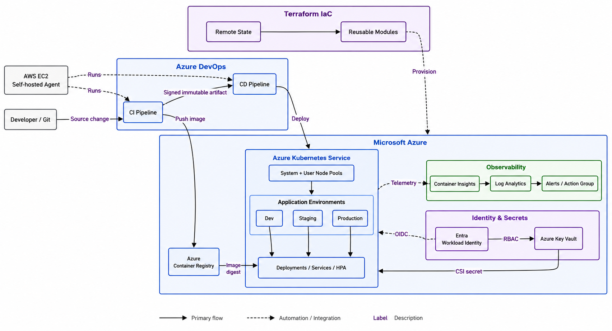

> Detailed architecture documentation: [docs/architecture.md](docs/architecture.md)

---

# Technology Stack

| Area                     | Technology                            |
| ------------------------ | ------------------------------------- |
| Cloud Platform           | Microsoft Azure                       |
| Infrastructure as Code   | Terraform                             |
| CI/CD                    | Azure DevOps YAML Pipelines           |
| Kubernetes               | Azure Kubernetes Service              |
| Container Registry       | Azure Container Registry              |
| Containers               | Docker                                |
| Application Platform     | Kubernetes                            |
| Configuration Management | Kustomize                             |
| Secrets                  | Azure Key Vault                       |
| Authentication           | Microsoft Entra Workload Identity     |
| Federation               | OIDC / Federated Identity Credentials |
| Security Scanning        | Trivy                                 |
| Artifact Signing         | Notation                              |
| Signing Key              | Azure Key Vault-backed key            |
| Monitoring               | Azure Monitor                         |
| Logging / Analytics      | Log Analytics                         |
| Kubernetes Monitoring    | Container Insights                    |
| Scaling                  | Kubernetes HPA / AKS node autoscaling |
| Pipeline Worker          | Self-hosted Azure DevOps agent        |
| Agent Infrastructure     | AWS EC2                               |
| Source Control           | Git                                   |
| Application              | Python                                |

---

# Architecture Components

The platform consists of several major layers.

## Infrastructure Layer

Terraform manages:

- Azure Resource Group
- Virtual Network
- AKS subnet
- private endpoint subnet
- Azure Kubernetes Service
- AKS system node pool
- AKS user node pool
- Azure Container Registry
- Azure Key Vault
- User Assigned Managed Identities
- Federated Identity Credentials
- Azure RBAC role assignments
- Log Analytics Workspace
- Azure Monitor resources
- Data Collection Rules
- diagnostic settings
- scheduled query alert rules
- Azure Monitor Action Groups

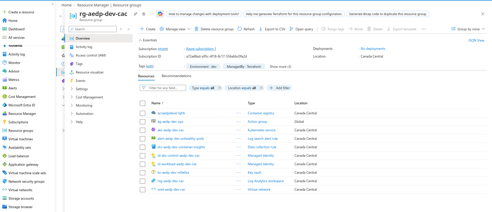

*Azure resource group overview demonstrating the Terraform-provisioned Azure platform footprint.*

## Platform Layer

The Kubernetes platform provides:

- application namespaces
- ServiceAccounts
- Workload Identity integration
- SecretProviderClass resources
- application Deployments
- Kubernetes Services
- Horizontal Pod Autoscalers
- environment-specific workload configuration

## Delivery Layer

Azure DevOps provides:

- CI pipelines
- CD pipelines
- reusable YAML templates
- security gates
- image build and publication
- immutable digest handling
- artifact signing
- artifact verification
- environment promotion
- production release governance

## Observability Layer

Azure-native monitoring provides:

- cluster telemetry
- workload telemetry
- centralized logs
- Kubernetes metrics
- AKS diagnostic logs
- scheduled query alerts
- notification Action Groups

---

# Repository Structure

```text
.
├── application/
│   ├── Dockerfile
│   ├── requirements.txt
│   └── src/
│       └── main.py
│
├── diagrams/
│   └── azure-enterprise-devops-platform.mmd
│
├── docs/
│   ├── architecture.md
│   ├── implementation.md
│   ├── ci-cd.md
│   ├── security.md
│   ├── monitoring.md
│   ├── troubleshooting.md
│   ├── screenshot-checklist.md
│   └── images/
│       ├── architecture/
│       ├── azure/
│       ├── terraform/
│       ├── aks/
│       ├── pipelines/
│       ├── security/
│       └── monitoring/
│
├── kubernetes/
│   ├── base/
│   ├── overlays/
│   │   ├── dev/
│   │   ├── staging/
│   │   └── prod/
│   └── platform/
│       ├── workload-identity/
│       └── key-vault-csi/
│
├── pipelines/
│   ├── ci/
│   │   └── application-ci.yml
│   ├── cd/
│   │   └── application-cd.yml
│   └── templates/
│       ├── python-validate.yml
│       ├── docker-build-push.yml
│       ├── trivy-filesystem-scan.yml
│       ├── trivy-image-scan.yml
│       ├── notation-sign-verify.yml
│       ├── notation-verify.yml
│       ├── deploy-job.yml
│       └── deploy-aks.yml
│
├── terraform/
│   ├── bootstrap/
│   ├── environments/
│   │   ├── dev/
│   │   ├── staging/
│   │   └── prod/
│   └── modules/
│       ├── acr/
│       ├── aks/
│       ├── identity/
│       ├── key-vault/
│       ├── monitoring/
│       └── networking/
│
└── README.md
```

This structure separates infrastructure, Kubernetes configuration, application code, pipeline logic, security controls, and engineering documentation while keeping each concern independently maintainable.

---

# Infrastructure as Code

Terraform is used as the authoritative mechanism for provisioning the Azure platform.

Rather than defining the entire platform in a single configuration, infrastructure is separated into reusable modules:

```text
terraform/modules/
├── acr
├── aks
├── identity
├── key-vault
├── monitoring
└── networking
```

This design improves:

- reusability;
- separation of concerns;
- maintainability;
- consistency;
- code review;
- future environment expansion.

Terraform environment composition is organized under:

```text
terraform/environments/
├── dev
├── staging
└── prod
```

The implemented portfolio platform currently provisions the shared Azure infrastructure from:

```text
terraform/environments/dev
```

The `staging` and `prod` directories preserve the intended repository structure for future dedicated infrastructure stacks.

In the current implementation, application environments are separated through:

- Kubernetes namespaces;
- Azure DevOps environments;
- federated identity credentials;
- environment-specific Kubernetes manifests;
- controlled CI/CD promotion.

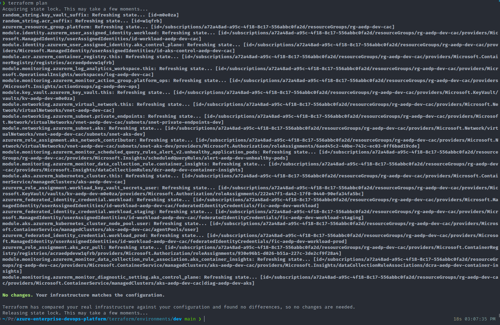

*Demonstrates reproducible Infrastructure as Code provisioning.*

---

# Terraform State Management

The primary platform Terraform state is stored remotely in Azure Storage rather than committed to source control.

The backend infrastructure is bootstrapped separately from the primary workload platform so that the backend remains available even when the application environment is destroyed.

This introduces an important bootstrap relationship:

```text
Bootstrap Terraform
       |
       v
Azure Storage Backend
       |
       v
Remote Terraform State
       |
       v
Application Platform Terraform
```

Any local bootstrap state, temporary plans, variable files, credentials, private keys, and other local Terraform artifacts remain excluded from source control through `.gitignore`.

The backend storage networking is also hardened so that access is not broadly permitted from arbitrary public networks.

This separation provides an important lifecycle property:

```text
Terraform Backend
       |
       | remains available
       v
Application Infrastructure
       |
       +--> Create
       +--> Modify
       +--> Destroy
       +--> Recreate
```

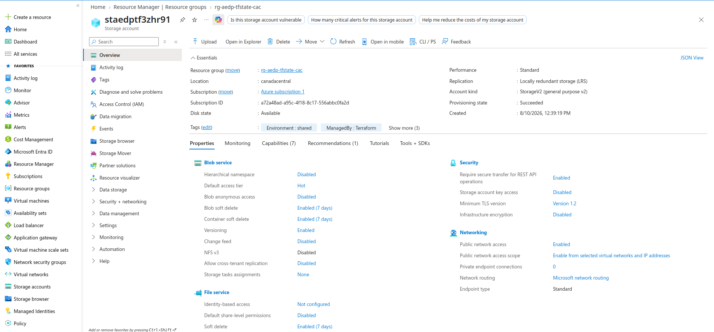

*Demonstrates remote state architecture and backend security.*

---

# Azure Networking

The networking layer provisions a dedicated Azure Virtual Network with separate subnets for platform workloads and future private-connectivity requirements.

Primary components include:

- Azure Virtual Network
- AKS subnet
- private endpoint subnet
- subnet-level permissions required by AKS

Networking is managed through the reusable Terraform networking module.

AKS receives the required Azure RBAC permissions over its subnet rather than relying on manually assigned or undocumented permissions.

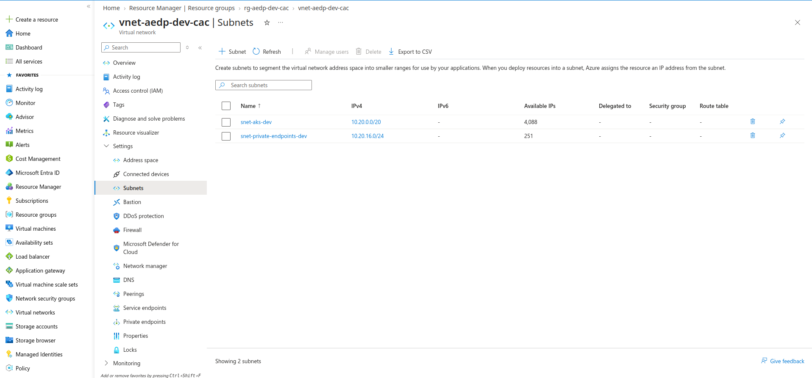

*Demonstrates Terraform-managed Azure networking.*

---

# AKS Architecture

Azure Kubernetes Service is the compute platform for application workloads.

The cluster uses separate system and user workload capacity.

The system node pool is intended for Kubernetes and platform-critical components, while application workloads execute on the user node pool.

Capabilities implemented include:

- Azure RBAC integration
- OIDC issuer
- Workload Identity
- system and user node pools
- cluster autoscaling
- Kubernetes Horizontal Pod Autoscaling
- ACR integration
- Key Vault CSI integration
- Azure Monitor integration
- Container Insights

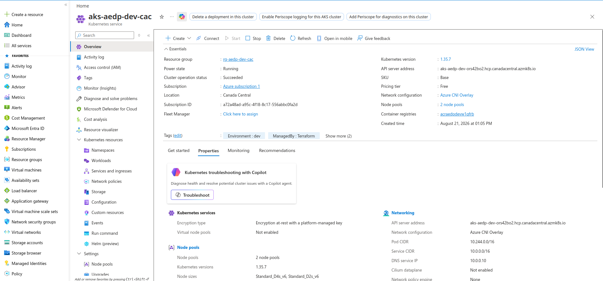

*Demonstrates the running AKS platform.*

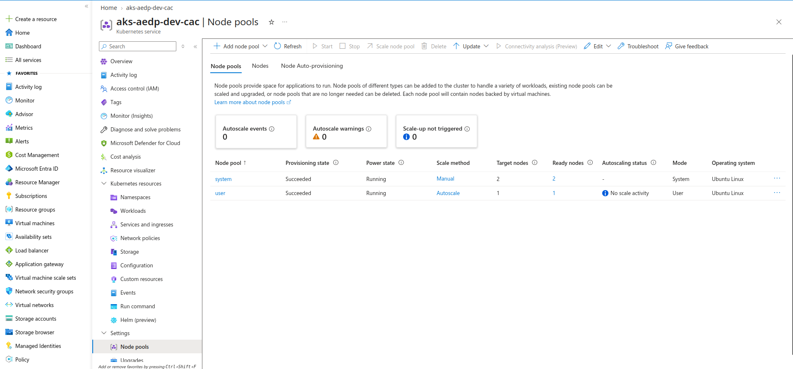

*Demonstrates workload separation and autoscaling configuration.*

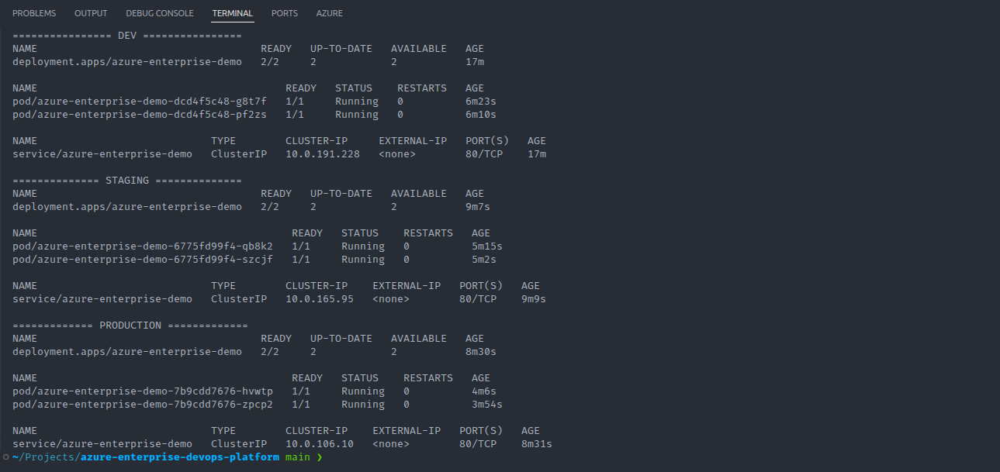

*Demonstrates healthy Kubernetes workloads.*

---

# Container Registry

Azure Container Registry provides the private image registry for application images produced by CI.

The application artifact lifecycle is:

```text
Source Code
     |
     v
Docker Build
     |
     v
Security Scan
     |
     v
Azure Container Registry
     |
     v
Immutable Digest
     |
     v
Notation Signature
     |
     v
Verified AKS Deployment
```

AKS receives ACR pull permission through Azure RBAC rather than storing registry credentials inside Kubernetes configuration.


*Demonstrates the private container image lifecycle.*

---

# Identity and Access Management

One of the key design goals was to avoid long-lived Azure credentials inside application workloads.

The platform uses:

- User Assigned Managed Identity
- AKS OIDC issuer
- Microsoft Entra Workload Identity
- Federated Identity Credentials
- Kubernetes ServiceAccounts
- Azure RBAC

The authentication flow is:

```text
Application Pod
      |
      v
Kubernetes ServiceAccount
      |
      v
AKS OIDC Issuer
      |
      v
Federated Identity Credential
      |
      v
User Assigned Managed Identity
      |
      v
Azure Resource
```

Separate federated identity relationships support the application namespaces used by Dev, Staging, and Production.

This removes the requirement to place Azure client secrets inside application manifests.


*Demonstrates secretless Azure authentication.*

---

# Secrets Management

Azure Key Vault acts as the application secret system of record.

AKS workloads retrieve secret material through the Azure Key Vault Secrets Store CSI integration using Microsoft Entra Workload Identity.

The secrets flow is:

```text
Azure Key Vault
      ^
      |
Managed Identity
      ^
      |
Federated Identity
      ^
      |
Kubernetes ServiceAccount
      ^
      |
Application Pod
```

The Secrets Store CSI integration retrieves the secret using Workload Identity and makes it available to the workload without embedding Azure credentials or secret values directly in the deployment manifests.


*Demonstrates centralized secrets management.*


*Demonstrates Key Vault CSI integration.*

> Secret values are intentionally excluded from portfolio screenshots and source control.

---

# Kubernetes Application Architecture

Kubernetes manifests use Kustomize to separate reusable application definitions from environment-specific configuration.

The reusable application base is maintained under:

```text
kubernetes/base/application/
├── deployment.yaml
├── service.yaml
├── hpa.yaml
└── kustomization.yaml
```

The Development workload uses the base application manifests together with shared platform resources under:

```text
kubernetes/platform/
├── workload-identity/
└── key-vault-csi/
```

Staging and Production use explicit environment-specific overlays:

```text
kubernetes/overlays/
├── staging/
└── prod/
```

These overlays include environment-specific:

- Namespace
- ServiceAccount
- SecretProviderClass
- Deployment
- Service
- HPA

This model minimizes duplication while allowing environment-specific customization where required.

---

# CI Pipeline

The CI pipeline validates the application, evaluates security, builds the container image, publishes it to ACR, captures an immutable digest, signs the artifact, verifies the signature, and retains security evidence.

Reusable pipeline templates are stored under:

```text
pipelines/templates/
```

Pipeline functionality includes:

1. application validation;
2. filesystem/source security scanning;
3. Docker image build;
4. image vulnerability scanning;
5. image publication to Azure Container Registry;
6. immutable image digest capture;
7. Notation signing using an Azure Key Vault-backed signing key;
8. signature verification;
9. machine-readable security evidence generation;
10. pipeline artifact publication.

Reusable templates include:

```text
python-validate.yml
docker-build-push.yml
trivy-filesystem-scan.yml
trivy-image-scan.yml
notation-sign-verify.yml
notation-verify.yml
deploy-job.yml
deploy-aks.yml
```

## Filesystem Security Scan

Trivy is executed against the source workspace before application delivery.

This shifts vulnerability and configuration detection toward the beginning of the software delivery lifecycle.


*Demonstrates shift-left DevSecOps control.*

## Container Image Scan

The resulting container image is scanned before being accepted into the deployment lifecycle.

This provides security coverage of the actual container artifact rather than relying only on source analysis.


*Demonstrates container supply-chain security gating.*

## Security Artifacts

Security results are published as pipeline artifacts in formats suitable for human investigation and automated processing.

These include JSON and SARIF reports.


*Demonstrates retained and auditable security evidence.*

## Artifact Signing and Verification

The CI pipeline captures the immutable container image digest and signs the artifact using Notation with an Azure Key Vault-backed signing key.

The corresponding trust certificate and trust policy are used to verify artifact provenance.

The supply-chain flow is:

```text
Build Image
     |
     v
Scan Image
     |
     v
Push to ACR
     |
     v
Capture Immutable Digest
     |
     v
Sign with Notation
     |
     v
Verify Signature
     |
     v
Publish Image Metadata
```

The CD pipeline independently verifies the signed artifact before deployment.

This establishes a stronger software supply-chain guarantee than deploying solely from a mutable image tag.

## CI Pipeline Evidence

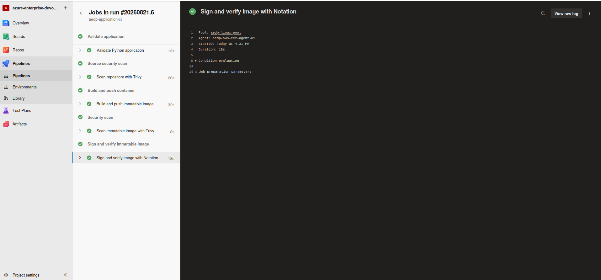

*Primary evidence of the CI implementation.*

---

# CD Pipeline

The CD pipeline consumes the image metadata produced by CI, verifies the signed artifact, and promotes the same immutable image digest through controlled deployment stages.

The overall workflow is:

```text
Signed ACR Image Digest
        |
        v
Signature Verification
        |
        v
Development
        |
        v
Validation
        |
        v
Staging
        |
        v
Validation
        |
        v
Production Approval
        |
        v
Production
```

The deployment model follows an important principle:

```text
Build Once
   |
   v
Verify Once
   |
   v
Promote the Same Immutable Artifact
```

Reusable deployment templates reduce duplication between environments while Kubernetes configuration provides environment-specific deployment behavior.


*Demonstrates automated Development deployment.*


*Demonstrates controlled environment promotion.*


*Demonstrates Production release governance.*


*Demonstrates complete Dev → Staging → Production delivery.*

---

# Environment Promotion Strategy

The project models three application delivery environments:

```text
Development
     |
     v
Staging
     |
     v
Production
```

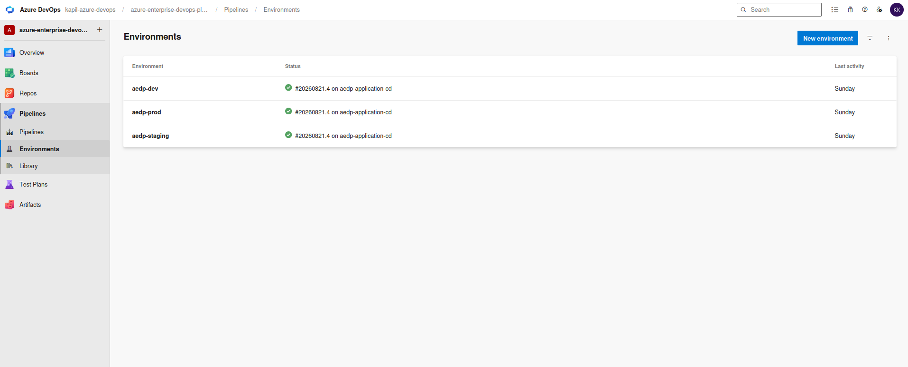

*Azure DevOps environments model the Dev → Staging → Production promotion path and provide governance boundaries for controlled releases.*

The purpose of environment promotion is not simply to run three copies of an application.

Each stage represents a different level of confidence.

### Development

Used for rapid deployment and initial validation.

### Staging

Provides pre-production verification using configuration representative of Production.

### Production

Represents the controlled release environment and requires stronger governance.

Production promotion is deliberately separated from lower environments so that Azure DevOps environment checks and approvals can be introduced before a Production change proceeds.

---

# DevSecOps Controls

Security is integrated into the delivery process rather than being treated as a final manual activity.

Implemented controls include:

- Trivy filesystem scanning
- Trivy container image scanning
- pipeline security gates
- JSON security reports
- SARIF security reports
- immutable image digest capture
- Notation container artifact signing
- Azure Key Vault-backed signing key
- signature verification before deployment
- immutable digest-based promotion
- non-root container execution
- Kubernetes SecurityContext controls
- Azure Key Vault
- Workload Identity
- Azure RBAC
- restricted Terraform backend networking
- sensitive Terraform artifacts excluded from Git

The objective is defense in depth:

```text
Source
  |
  +--> Filesystem Scan
  |
Container Image
  |
  +--> Image Scan
  |
Registry
  |
  +--> Controlled Access
  |
Artifact
  |
  +--> Immutable Digest
  |
  +--> Notation Signature
  |
Deployment
  |
  +--> Signature Verification
  |
Kubernetes
  |
  +--> Hardened Workload
  |
Identity
  |
  +--> Workload Identity
  |
Secrets
  |
  +--> Azure Key Vault
```

---

# Container Security

Application workloads are hardened using Kubernetes runtime security controls.

The deployment configuration includes:

- non-root execution;
- explicit SecurityContext settings;
- restricted privilege;
- RuntimeDefault seccomp;
- resource requests and limits;
- readiness and liveness probes.

The objective is to ensure that the application does not depend on unnecessary root-level permissions or elevated container privileges.


*Demonstrates workload runtime hardening.*

---

# Observability and Monitoring

The platform uses Azure-native observability components.

Terraform provisions and integrates:

- Log Analytics Workspace
- Azure Monitor
- Container Insights
- Data Collection Rules
- AKS diagnostic settings
- scheduled query alert rules
- Azure Monitor Action Group

This provides visibility into Kubernetes workloads and AKS platform activity.

## Container Insights

Container Insights provides operational visibility into AKS nodes, controllers, pods, and containers.

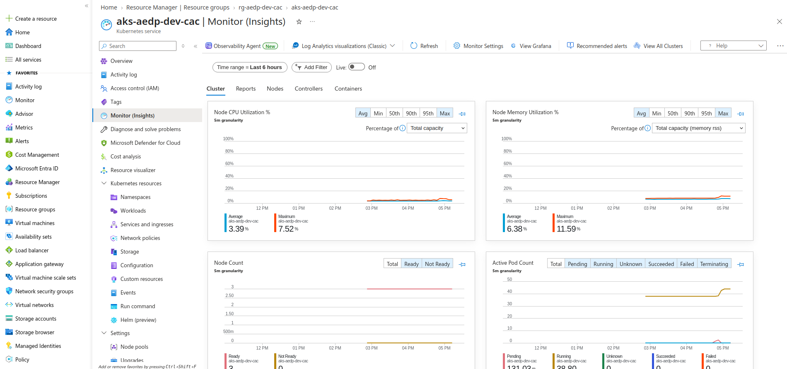

*Demonstrates Azure-native Kubernetes observability.*

## Log Analytics

Log Analytics provides a centralized workspace for querying Azure and Kubernetes telemetry using KQL.

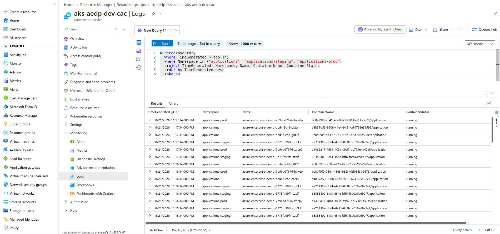

*Demonstrates query-driven operational investigation.*

## Alerting

An Azure Monitor scheduled query alert detects unhealthy application pod conditions.

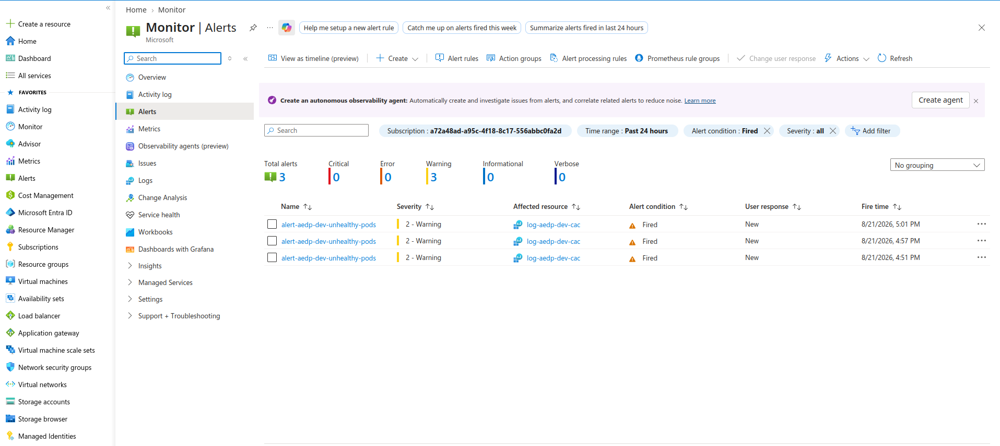

*Demonstrates proactive operational alerting.*

The scheduled query alert integrates with an Azure Monitor Action Group that defines the notification path for operational events.

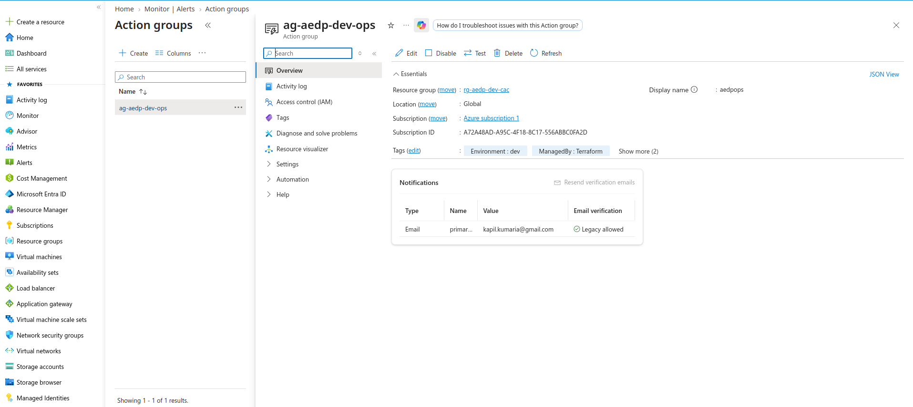

*Demonstrates the alert notification and response architecture.*

---

# Autoscaling

The platform implements scaling at multiple layers.

## Application Scaling

Kubernetes Horizontal Pod Autoscaler resources allow application replicas to adjust according to workload demand.

## Cluster Capacity

AKS node pool autoscaling allows worker capacity to adjust within configured minimum and maximum limits.

These mechanisms work together:

```text
Application Demand
       |
       v
Kubernetes HPA
       |
       v
More Pods
       |
       v
Insufficient Node Capacity?
       |
       v
AKS Cluster Autoscaler
       |
       v
Additional Node Capacity
```

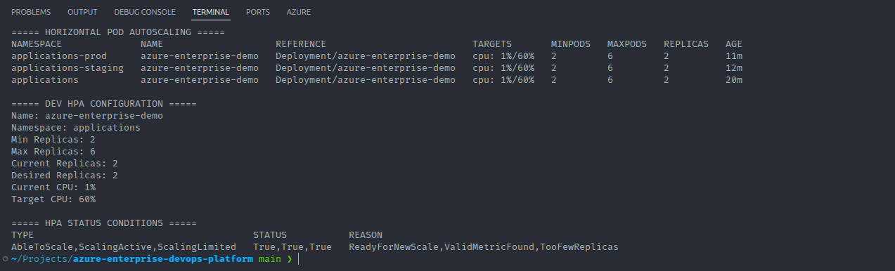

*Demonstrates application autoscaling.*

---

# End-to-End Delivery Workflow

A typical application change follows this lifecycle:

```text
Developer Change
      |
      v
Git Repository
      |
      v
Azure DevOps CI
      |
      +--> Validate Application
      |
      +--> Trivy Filesystem Scan
      |
      +--> Build Docker Image
      |
      +--> Trivy Image Scan
      |
      +--> Push Image to ACR
      |
      +--> Capture Immutable Digest
      |
      +--> Sign Artifact with Notation
      |
      +--> Verify Signature
      |
      +--> Publish Security Evidence
      |
      v
Azure DevOps CD
      |
      +--> Validate CI Image Metadata
      |
      +--> Verify Signed Artifact
      |
      +--> Deploy Dev
      |
      +--> Validate Dev
      |
      +--> Deploy Staging
      |
      +--> Validate Staging
      |
      +--> Production Approval
      |
      +--> Deploy Production
      |
      v
AKS
      |
      +--> Workload Identity
      +--> Azure Key Vault
      +--> HPA
      +--> Azure Monitor
```

This provides an automated path from application source to Production while preserving artifact integrity, security controls, release governance, and operational visibility.

---

# Infrastructure Lifecycle and Recoverability

The Azure workload platform is designed to be destroyable and reproducible.

A complete lifecycle follows:

```text
Terraform Configuration
      |
      v
terraform apply
      |
      v
Azure Platform
      |
      v
Application Deployment
      |
      v
Validation
      |
      v
terraform destroy
      |
      v
terraform apply
      |
      v
Recreated Platform
```

The Terraform backend is managed separately so that state management remains available across application platform rebuilds.

This also reduces unnecessary Azure cost for a portfolio and lab environment.


*Demonstrates infrastructure reproducibility and lifecycle management.*

---

# Key Engineering Decisions

## Terraform Instead of Manual Provisioning

Infrastructure must be reproducible, reviewable, auditable, and version controlled.

Terraform provides declarative lifecycle management and allows the Azure platform to be recreated consistently.

## AKS Instead of Individually Managed Virtual Machines

AKS provides a managed Kubernetes control plane and allows engineering effort to focus on workload orchestration, identity, security, scaling, deployment, and observability rather than manually managing Kubernetes control-plane infrastructure.

## ACR for Container Images

Azure Container Registry provides a private container registry with native Azure RBAC and AKS integration.

## Workload Identity Instead of Client Secrets

Long-lived client secrets create rotation, leakage, and operational-management risks.

OIDC federation allows Kubernetes workloads to authenticate to Azure resources without storing Azure credentials in application configuration.

## Key Vault as the Application Secret System of Record

Azure Key Vault remains the authoritative source for application secret material.

The Secrets Store CSI integration retrieves secret material using Workload Identity, avoiding embedded Azure credentials and directly committed secret values.

## Kustomize for Environment Configuration

Kustomize allows reusable application configuration while preserving environment-specific customization where required.

The Development environment uses the reusable base, while Staging and Production use dedicated overlays.

## Reusable Pipeline Templates

Reusable Azure DevOps YAML templates reduce duplicated pipeline logic and ensure that security and deployment behavior remain consistent.

## Security Scanning at Multiple Stages

Filesystem scanning and image scanning address different risk surfaces.

Scanning only source code cannot guarantee that the final container artifact is clean, while scanning only the final image detects problems later in the delivery lifecycle.

## Artifact Signing and Immutable Promotion

Container image tags are mutable.

The platform therefore captures immutable digests, signs artifacts using Notation, verifies artifact provenance, and promotes the same digest through deployment environments.

This creates a stronger build-once/promote-many delivery model.

## Controlled Production Promotion

Production requires a higher level of governance than Development.

Azure DevOps environments therefore provide a distinct Production release boundary with approval controls.

---

# Challenges and Troubleshooting

A major part of building the platform involved troubleshooting real integration issues across Terraform, Azure, Kubernetes, identity, security tooling, artifact signing, and Azure DevOps.

Examples include:

- Terraform backend networking
- AKS authorization and Azure RBAC
- Workload Identity federation
- environment-specific federated credentials
- Key Vault access
- Azure DevOps service connection permissions
- self-hosted pipeline agent behavior
- ACR access
- Notation trust and signing configuration
- Key Vault-backed signing permissions
- Kubernetes SecurityContext requirements
- image digest handling
- security pipeline behavior
- multi-environment deployment promotion
- Container Insights integration
- Azure Monitor alert configuration

Detailed root-cause analysis and corrective actions are maintained in:

[docs/troubleshooting.md](docs/troubleshooting.md)

The troubleshooting documentation follows the engineering pattern:

```text
Problem
   |
   v
Symptoms
   |
   v
Investigation
   |
   v
Root Cause
   |
   v
Remediation
   |
   v
Validation
   |
   v
Lesson Learned
```

---

# Production Improvements

This project intentionally demonstrates core enterprise platform patterns without attempting to reproduce every control used by a large production organization.

For a higher-scale production implementation, potential improvements would include:

- private AKS API endpoint;
- private endpoints for Azure PaaS services;
- Azure Firewall or equivalent centralized egress control;
- Azure Policy and Kubernetes admission-policy enforcement;
- dedicated Azure subscriptions per environment;
- independent AKS clusters where stronger environment isolation is required;
- stronger Terraform backend governance through private connectivity, least-privilege RBAC, PIM, and change controls;
- Azure DevOps variable groups integrated with Key Vault where appropriate;
- broader policy-as-code enforcement;
- Software Bill of Materials generation;
- SLSA-aligned software supply-chain controls;
- stronger artifact trust policies;
- distributed tracing;
- SLIs and SLOs;
- backup and disaster recovery procedures;
- multi-region resiliency where required;
- centralized enterprise identity governance;
- Privileged Identity Management;
- dedicated Production self-hosted agents;
- autoscaled Azure DevOps agents;
- centralized cost governance;
- automated compliance reporting.

These controls would be selected based on application criticality, regulatory requirements, recovery objectives, organizational maturity, security posture, and cost constraints rather than added solely for architectural complexity.

---

# Project Outcomes

The resulting platform demonstrates the ability to:

- provision Azure infrastructure through Terraform;
- design reusable Terraform modules;
- use remote Terraform state for the primary workload platform;
- manage AKS and supporting Azure services;
- design system and user node pool separation;
- implement Kubernetes application deployment patterns;
- build multi-stage Azure DevOps pipelines;
- create reusable pipeline templates;
- integrate Trivy vulnerability scanning into CI;
- retain JSON and SARIF security evidence;
- build and publish container images to ACR;
- capture immutable container image digests;
- sign container artifacts using Notation and Azure Key Vault;
- verify artifact provenance before deployment;
- promote the same immutable artifact across environments;
- secure Kubernetes workloads using non-root execution and SecurityContext controls;
- implement secretless cloud authentication using Workload Identity;
- integrate AKS workloads with Azure Key Vault;
- promote releases across Development, Staging, and Production;
- introduce Production release governance;
- implement Kubernetes Horizontal Pod Autoscaling;
- configure AKS node autoscaling;
- configure Azure-native monitoring and alerting;
- use Container Insights and Log Analytics for operational visibility;
- securely manage infrastructure lifecycle;
- destroy and recreate cloud infrastructure from code.

---

# Evidence and Screenshots

The screenshots in this repository provide implementation evidence rather than simply displaying Azure portal pages.

They are organized by capability:

```text
docs/images/
├── architecture/
├── azure/
├── terraform/
├── aks/
├── pipelines/
├── security/
└── monitoring/
```

Evidence includes:

- architecture;
- Terraform provisioning;
- Terraform backend configuration;
- Azure infrastructure;
- AKS;
- ACR;
- Workload Identity;
- Key Vault;
- Key Vault CSI;
- Kubernetes workloads;
- Kubernetes SecurityContext;
- CI pipeline;
- Trivy filesystem scanning;
- Trivy image scanning;
- retained security artifacts;
- Dev deployment;
- Staging deployment;
- Production approval;
- Production deployment;
- Azure DevOps environments;
- Horizontal Pod Autoscaling;
- Container Insights;
- Log Analytics;
- Azure Monitor scheduled query alerting;
- Azure Monitor Action Group.

---

# Detailed Documentation

Additional technical documentation is maintained under `docs/`.

| Document                                   | Purpose                                                                                 |
| ------------------------------------------ | --------------------------------------------------------------------------------------- |
| [Architecture](docs/architecture.md)       | Architecture, data flows, identity flows, and engineering decisions                     |
| [Implementation](docs/implementation.md)   | Detailed platform implementation walkthrough                                            |
| [CI/CD](docs/ci-cd.md)                     | Azure DevOps CI/CD design, artifact handling, and reusable pipeline architecture        |
| [Security](docs/security.md)               | DevSecOps, Workload Identity, secrets, RBAC, artifact security, and container hardening |
| [Monitoring](docs/monitoring.md)           | Azure Monitor, Log Analytics, Container Insights, DCRs, alerts, and Action Groups       |
| [Troubleshooting](docs/troubleshooting.md) | Problems encountered, investigation, root causes, remediation, and lessons learned      |

---

# Deployment

The implemented Terraform workload environment is located under:

```bash
cd terraform/environments/dev
```

Initialize Terraform:

```bash
terraform init
```

Validate the configuration:

```bash
terraform validate
```

Review the infrastructure plan:

```bash
terraform plan
```

Provision the platform:

```bash
terraform apply
```

Application delivery is subsequently managed through the Azure DevOps CI/CD pipelines and Kubernetes configuration contained in this repository.

> Environment-specific credentials, state files, Terraform variable files, private keys, plans, and other sensitive local artifacts must not be committed to source control.

---

# Destroying the Environment

Because this is a portfolio/lab platform, Azure workload resources can be destroyed when they are not actively required.

From the Terraform workload environment:

```bash
cd terraform/environments/dev
terraform plan -destroy
terraform destroy
```

Always review the destroy plan before approving resource deletion.

The backend infrastructure is treated separately from the workload platform so that Terraform state management remains available when the workload infrastructure is recreated.

---

# Status

**Project implementation: Complete**

The platform has been provisioned, validated, destroyed, recreated, and exercised through the complete CI/CD delivery lifecycle.

Validated capabilities include:

- Terraform-based Azure infrastructure provisioning;
- remote workload-platform Terraform state;
- AKS system and user node pools;
- Azure Container Registry integration;
- Microsoft Entra Workload Identity;
- Azure Key Vault CSI integration;
- Dev → Staging → Production deployment promotion;
- Production approval governance;
- Trivy source and container image security gates;
- retained JSON/SARIF security evidence;
- immutable image digest handling;
- Notation artifact signing;
- Azure Key Vault-backed signing;
- signature verification before deployment;
- hardened Kubernetes workloads;
- Horizontal Pod Autoscaling;
- AKS node autoscaling;
- Azure Monitor;
- Container Insights;
- Log Analytics;
- scheduled query alerting;
- Azure Monitor Action Groups;
- infrastructure destruction and reproducible recreation.

The Azure workload infrastructure may be destroyed when not required to minimize portfolio/lab operating cost.

The repository remains the authoritative definition required to recreate the platform.

---

# Author

**Kapil Kumaria**

Senior DevOps / Cloud Platform Engineering Portfolio Project