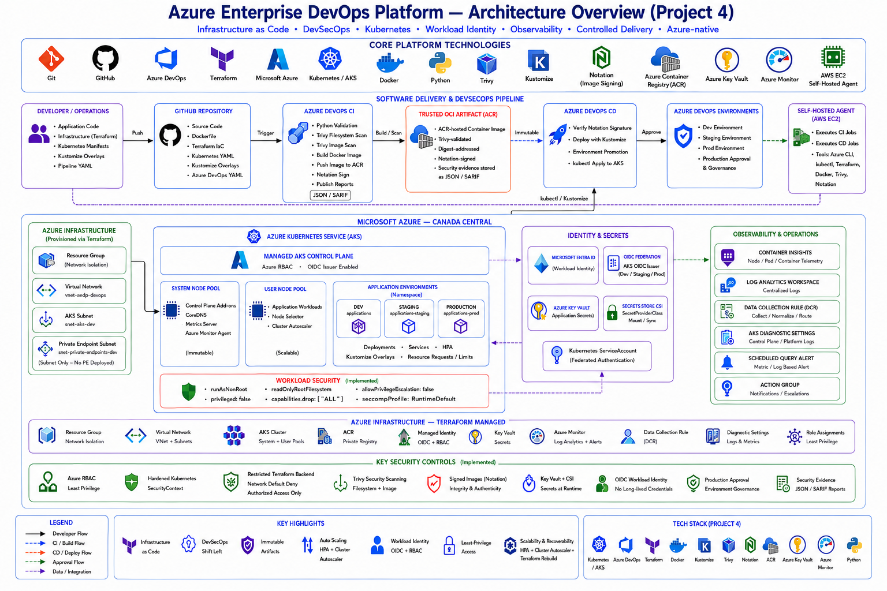

# Azure Enterprise DevOps Platform — Architecture

## Platform Architecture

The following diagram presents the end-to-end architecture of the platform, including infrastructure provisioning, Azure DevOps delivery workflows, AKS workload architecture, identity federation, secrets management, security controls, and Azure-native observability.




## Overview

The Azure Enterprise DevOps Platform is designed as a production-oriented cloud-native delivery platform for containerized applications running on Azure Kubernetes Service.

The architecture combines:

* Microsoft Azure
* Azure DevOps
* Terraform
* Azure Kubernetes Service
* Azure Container Registry
* Azure Key Vault
* Microsoft Entra Workload Identity
* Kustomize
* Trivy
* Azure Monitor
* Log Analytics
* self-hosted Azure DevOps agents

The platform separates infrastructure provisioning, application delivery, identity, security, secrets management, and observability into distinct architectural concerns.

---

# High-Level Architecture

The overall platform consists of five logical layers:

```text
Developer / Source Control
          |
          v
CI/CD Orchestration
          |
          v
Artifact / Container Registry
          |
          v
Kubernetes Runtime Platform
          |
          v
Azure Identity, Secrets, and Observability
```

Terraform operates across the Azure infrastructure layer and provisions the majority of the cloud resources required by the platform.

---

# Logical Architecture

```text
Developer
   |
   v
Git Repository
   |
   v
Azure DevOps
   |
   +-------------------------------+
   |                               |
   v                               v
CI Pipeline                    CD Pipeline
   |                               |
   |                               |
   +--> Validate                    +--> Dev
   +--> Trivy FS Scan               |
   +--> Docker Build                +--> Staging
   +--> Trivy Image Scan            |
   +--> Publish Reports             +--> Production Approval
   |                               |
   v                               +--> Production
Azure Container Registry            |
   |                               |
   +---------------+---------------+
                   |
                   v
          Azure Kubernetes Service
                   |
        +----------+-----------+
        |          |           |
        v          v           v
      Dev       Staging       Prod
        |
        +-----------------------------+
        |                             |
        v                             v
Workload Identity                Azure Monitor
        |
        v
Azure Key Vault
```

---

# Platform Boundaries

The project contains several distinct architectural boundaries.

## Source and Delivery Boundary

Azure DevOps provides the application delivery control plane.

Responsibilities include:

* source-triggered CI execution;
* application validation;
* vulnerability scanning;
* container image creation;
* image publication;
* deployment orchestration;
* environment promotion;
* production approval.

The pipeline implementation is stored as code in the repository.

---

## Azure Infrastructure Boundary

Terraform provisions the underlying Azure resources.

The primary Azure infrastructure includes:

* Resource Group;
* Virtual Network;
* AKS subnet;
* private endpoint subnet;
* Azure Kubernetes Service;
* Azure Container Registry;
* Azure Key Vault;
* Log Analytics Workspace;
* Azure Monitor integration;
* Managed Identities;
* Federated Identity Credentials;
* Azure RBAC assignments.

Terraform is therefore responsible for the cloud platform lifecycle rather than individual engineers manually configuring resources through the Azure Portal.

---

# Terraform Architecture

Terraform is divided into three major layers:

```text
terraform/
├── bootstrap/
├── environments/
└── modules/
```

## Bootstrap Layer

The bootstrap layer creates the infrastructure required for Terraform remote state.

This layer is intentionally separated from the main application platform lifecycle.

The design allows the workload infrastructure to be destroyed while the Terraform backend remains available.

Conceptually:

```text
Terraform Bootstrap
       |
       v
Remote State Backend
       |
       +--------------------------+
                                  |
                                  v
                      Terraform Environment
                                  |
                                  v
                         Azure Platform
```

This separation prevents the Terraform environment from destroying the state backend that it depends on.

---

## Environment Layer

The environment layer assembles reusable Terraform modules.

The primary implemented environment is:

```text
terraform/environments/dev
```

The repository also contains environment structure for:

```text
terraform/environments/staging
terraform/environments/prod
```

In the current portfolio architecture, the Azure infrastructure is shared while application environments are primarily separated at the Kubernetes namespace and configuration-overlay level.

This provides a cost-effective portfolio implementation while still demonstrating environment promotion and configuration isolation.

A larger production organization could instead deploy separate Azure subscriptions, resource groups, or AKS clusters for each environment.

---

# Terraform Module Architecture

Reusable Terraform modules are maintained under:

```text
terraform/modules/
├── acr
├── aks
├── identity
├── key-vault
├── monitoring
└── networking
```

Each module represents an infrastructure responsibility.

## Networking Module

Responsible for:

* Azure Virtual Network;
* AKS subnet;
* private endpoint subnet.

## AKS Module

Responsible for:

* Azure Kubernetes Service;
* system node pool;
* user node pool;
* OIDC enablement;
* Workload Identity enablement;
* cluster autoscaling configuration.

## ACR Module

Responsible for:

* Azure Container Registry.

The registry provides the trusted container image source consumed by AKS.

## Identity Module

Responsible for:

* AKS control-plane managed identity;
* application workload managed identity.

## Key Vault Module

Responsible for:

* Azure Key Vault;
* secret-access integration.

## Monitoring Module

Responsible for:

* Log Analytics Workspace;
* Data Collection Rule;
* Data Collection Rule association;
* AKS diagnostic settings;
* scheduled query alert;
* Action Group.

---

# Azure Network Architecture

The platform uses a dedicated Azure Virtual Network.

Conceptually:

```text
Azure Virtual Network
|
+-- AKS Subnet
|
|   +-- AKS Nodes
|   +-- Kubernetes Workloads
|
+-- Private Endpoint Subnet
    |
    +-- Reserved for private Azure service connectivity
```

The AKS cluster is deployed into the dedicated AKS subnet.

The private endpoint subnet provides architectural capacity for stronger private connectivity patterns where required.

---

# AKS Architecture

Azure Kubernetes Service is the workload execution layer.

The AKS platform includes:

* managed Kubernetes control plane;
* system node pool;
* user node pool;
* Kubernetes namespaces;
* Kubernetes Deployments;
* Services;
* ServiceAccounts;
* SecretProviderClass resources;
* Horizontal Pod Autoscalers.

The architecture separates platform workloads from application workloads.

```text
AKS Cluster
|
+-- System Node Pool
|   |
|   +-- Kubernetes system workloads
|   +-- cluster-critical services
|
+-- User Node Pool
    |
    +-- application workloads
```

This separation prevents application workloads from competing directly with critical Kubernetes platform services.

---

# Application Environment Architecture

The delivery process models three application environments:

```text
Dev
 |
 v
Staging
 |
 v
Production
```

These environments are represented through Kubernetes namespaces and Kustomize overlays.

The repository contains:

```text
kubernetes/overlays/
├── dev
├── staging
└── prod
```

Environment-specific configuration can differ while the common application definition remains reusable.

---

# Kubernetes Configuration Architecture

The Kubernetes configuration follows a base-and-overlay pattern.

```text
kubernetes/
|
+-- base/
|   |
|   +-- application/
|
+-- overlays/
|   |
|   +-- dev/
|   +-- staging/
|   +-- prod/
|
+-- platform/
    |
    +-- key-vault-csi/
    +-- workload-identity/
```

The base contains common application resources.

Environment overlays modify or extend those resources without requiring complete copies of every Kubernetes manifest.

This reduces configuration drift and duplication.

---

# Container Image Architecture

Application container images are built by Azure DevOps and stored in Azure Container Registry.

The flow is:

```text
Application Source
      |
      v
Docker Build
      |
      v
Trivy Image Scan
      |
      v
Azure Container Registry
      |
      v
AKS
```

AKS receives Azure RBAC permission to pull images from ACR.

Registry credentials therefore do not need to be embedded in Kubernetes manifests.

---

# CI Architecture

The CI pipeline performs multiple validation and security stages before application deployment.

```text
Commit / Pull Request
       |
       v
Application Validation
       |
       v
Trivy Filesystem Scan
       |
       v
Docker Build
       |
       v
Trivy Image Scan
       |
       v
Security Reports
       |
       v
Push to ACR
```

Reusable YAML templates provide consistent behavior across pipeline stages.

The templates include:

```text
python-validate.yml
trivy-filesystem-scan.yml
docker-build-push.yml
trivy-image-scan.yml
notation-sign-verify.yml
notation-verify.yml
```

This architecture reduces pipeline duplication and makes security controls reusable.

---

# CD Architecture

The CD pipeline promotes a validated application image across multiple environments.

```text
Validated Container Image
         |
         v
        Dev
         |
         v
   Dev Validation
         |
         v
      Staging
         |
         v
 Staging Validation
         |
         v
Production Approval
         |
         v
    Production
```

The same container artifact should be promoted between environments rather than rebuilding unrelated images for each stage.

This reduces the risk of environmental differences between tested and production artifacts.

---

# Self-Hosted Azure DevOps Agent

The project uses a self-hosted Azure DevOps agent running on AWS EC2.

Architecturally:

```text
Azure DevOps
     |
     | pipeline job
     v
AWS EC2 Self-Hosted Agent
     |
     +--> Terraform
     +--> Azure CLI
     +--> kubectl
     +--> Docker
     +--> Trivy
     |
     v
Microsoft Azure
```

This demonstrates that Azure DevOps execution agents are not required to run inside Azure.

Azure DevOps acts as the pipeline control plane, while the execution worker can reside on another infrastructure platform.

For a production Azure environment, an organization could instead use:

* Microsoft-hosted agents;
* Azure VM Scale Set agents;
* Kubernetes-based agents;
* dedicated self-hosted Azure agents.

---

# Identity Architecture

Identity is intentionally separated into multiple responsibilities.

## AKS Control Plane Identity

A User Assigned Managed Identity is used by the AKS control plane for Azure resource operations.

## Workload Identity

A separate User Assigned Managed Identity is associated with application workloads.

This avoids using the AKS control-plane identity for application-level Azure resource access.

The workload authentication architecture is:

```text
Application Pod
      |
      v
Kubernetes ServiceAccount
      |
      v
ServiceAccount Token
      |
      v
AKS OIDC Issuer
      |
      v
Microsoft Entra ID
      |
      v
Federated Identity Credential
      |
      v
User Assigned Managed Identity
      |
      v
Azure Resource
```

This is a token federation model rather than a stored-client-secret model.

---

# Federated Identity Architecture

Federated Identity Credentials establish trust between Kubernetes ServiceAccounts and Microsoft Entra managed identities.

The platform contains federated identity relationships for application environments including:

* Dev;
* Staging;
* Production.

The federation typically identifies:

* OIDC issuer;
* Kubernetes namespace;
* Kubernetes ServiceAccount;
* Azure managed identity.

This provides environment-aware identity while avoiding static Azure credentials.

---

# Key Vault and Secret Flow

Azure Key Vault provides centralized secret storage.

The secret-access path is:

```text
Application Pod
      |
      v
Kubernetes ServiceAccount
      |
      v
Workload Identity Federation
      |
      v
Managed Identity
      |
      v
Azure Key Vault
      |
      v
Secrets Store CSI Driver
      |
      v
Application
```

The application does not require a long-lived Azure client secret.

The Kubernetes manifest instead references the identity and SecretProviderClass configuration.

---

# RBAC Architecture

Azure RBAC is applied according to resource responsibility.

Important examples include:

```text
AKS Identity
    |
    +--> Network Contributor
    |       |
    |       +--> AKS Subnet
    |
    +--> ACR Pull
            |
            +--> Azure Container Registry
```

Application workload identity receives the minimum Key Vault permissions required to access application secrets.

The goal is least-privilege resource access rather than broad subscription-level permissions.

---

# Security Architecture

Security controls are implemented at multiple layers.

```text
Source Code
    |
    +--> Trivy Filesystem Scan
    |
Container Image
    |
    +--> Trivy Image Scan
    |
Container Runtime
    |
    +--> Non-root execution
    +--> SecurityContext
    |
Cloud Identity
    |
    +--> Workload Identity
    +--> Federated credentials
    |
Secrets
    |
    +--> Azure Key Vault
    |
Infrastructure
    |
    +--> Terraform
    +--> RBAC
    +--> Backend network restrictions
```

This provides defense in depth rather than relying on a single security mechanism.

---

# Terraform Backend Security Architecture

Terraform state is treated as sensitive infrastructure data.

Controls include:

* remote state;
* state files excluded from Git;
* Terraform plan artifacts excluded from Git;
* variable files excluded from Git;
* restricted backend storage networking;
* controlled administrator access;
* Azure service bypass where required.

The Terraform backend is deliberately kept separate from the ephemeral AKS platform lifecycle.

---

# Container Security Architecture

Application containers are configured to avoid unnecessary privilege.

Kubernetes SecurityContext configuration provides controls such as:

* non-root execution;
* explicit user configuration where applicable;
* restricted privilege escalation;
* container runtime hardening.

Security scanning occurs before deployment so known high-impact vulnerabilities can fail the pipeline rather than reaching production.

---

# Observability Architecture

The observability architecture is based primarily on Azure-native services.

```text
AKS
 |
 +--> Container Insights
 |
 +--> Diagnostic Settings
 |
 +--> Data Collection Rule
 |
 v
Log Analytics Workspace
 |
 +--> Queries
 +--> Operational Investigation
 |
 v
Azure Monitor
 |
 +--> Alert Rules
 |
 v
Action Group
```

This allows both interactive troubleshooting and automated alerting.

---

# Log Analytics

Log Analytics acts as the centralized telemetry workspace.

It can receive information associated with:

* AKS workloads;
* containers;
* cluster operations;
* Kubernetes resources;
* Azure platform diagnostics.

Kusto Query Language can then be used for operational investigation.

---

# Azure Monitor Alerts

The project includes an Azure Monitor scheduled query alert intended to detect unhealthy application pod conditions.

The monitoring path is:

```text
Kubernetes Condition
       |
       v
Telemetry Collection
       |
       v
Log Analytics
       |
       v
Scheduled Query Rule
       |
       v
Azure Monitor Alert
       |
       v
Action Group
```

This demonstrates proactive monitoring rather than relying only on manual dashboard inspection.

---

# Scaling Architecture

Scaling occurs at both application and cluster capacity levels.

```text
Incoming Workload
       |
       v
Application Resource Pressure
       |
       v
Kubernetes HPA
       |
       v
Additional Pods
       |
       v
Insufficient Node Capacity
       |
       v
AKS Cluster Autoscaler
       |
       v
Additional Worker Nodes
```

The HPA handles application replica scaling.

The AKS Cluster Autoscaler handles infrastructure capacity scaling.

These mechanisms solve different layers of the scaling problem.

---

# Release Governance

Development, staging, and production environments represent progressively stronger validation boundaries.

```text
Development
    |
    | automated
    v
Staging
    |
    | validated
    v
Production Approval
    |
    | authorized
    v
Production
```

Production approval provides an explicit governance boundary.

In a real enterprise environment, approval could be combined with:

* change-management requirements;
* automated quality gates;
* security gates;
* separation of duties;
* deployment windows.

---

# Infrastructure Lifecycle

One important architectural goal is reproducibility.

The platform is designed to support:

```text
Code
 |
 v
terraform apply
 |
 v
Azure Infrastructure
 |
 v
Application Deployment
 |
 v
Operation / Validation
 |
 v
terraform destroy
 |
 v
Environment Removed
```

Later, the same infrastructure code can recreate the platform.

This makes the environment disposable while the architecture remains reproducible.

---

# Availability and Resilience

The portfolio architecture implements several resilience patterns including:

* AKS managed control plane;
* multiple Kubernetes replicas where configured;
* Horizontal Pod Autoscaling;
* cluster node autoscaling;
* separate system and user node pools;
* automated CI/CD recreation of workloads;
* Terraform-based infrastructure recreation.

For production workloads with stronger availability requirements, additional controls could include:

* Availability Zone-aware node pools;
* multiple replicas across zones;
* PodDisruptionBudgets;
* topology spread constraints;
* multi-region disaster recovery;
* geo-replicated registries;
* zone-redundant supporting services.

---

# Environment Isolation Model

The current implementation intentionally uses a shared Azure platform for portfolio cost efficiency.

Application environments are separated primarily through:

* Kubernetes namespaces;
* Kustomize overlays;
* environment-specific ServiceAccounts;
* federated identity relationships;
* pipeline deployment stages.

This provides logical separation.

A larger enterprise implementation may require stronger isolation such as:

```text
Development Subscription
        |
        +--> Dev AKS

Staging Subscription
        |
        +--> Staging AKS

Production Subscription
        |
        +--> Production AKS
```

The appropriate isolation model depends on:

* compliance;
* blast radius;
* security requirements;
* organizational structure;
* cost;
* workload criticality.

---

# Trust Boundaries

Important trust boundaries in the architecture include:

1. Developer to source repository
2. Source repository to Azure DevOps pipeline
3. Azure DevOps to self-hosted build agent
4. Build agent to Azure
5. AKS to ACR
6. Kubernetes ServiceAccount to Microsoft Entra ID
7. Managed Identity to Azure Key Vault
8. AKS telemetry to Azure Monitor and Log Analytics

Each boundary should use authenticated, authorized, and auditable access.

---

# Architecture Diagram Requirements

The final architecture diagram should include the following components.

## Developer and Delivery

* Developer
* Git repository
* Azure DevOps
* CI pipeline
* CD pipeline
* AWS EC2 self-hosted agent

## Terraform

* Terraform
* remote backend
* reusable modules

## Azure

* Resource Group
* Virtual Network
* AKS subnet
* private endpoint subnet
* AKS
* ACR
* Key Vault
* Managed Identities
* Log Analytics
* Azure Monitor

## Kubernetes

* System node pool
* User node pool
* Dev namespace
* Staging namespace
* Production namespace
* ServiceAccounts
* HPA
* Key Vault CSI integration

## Identity Flow

* AKS OIDC issuer
* Federated Identity Credentials
* Workload Managed Identity
* Azure Key Vault

## Delivery Flow

* CI
* Trivy
* Docker build
* ACR
* Dev
* Staging
* Production approval
* Production

---

# Final Architecture Principles

The architecture follows several key engineering principles:

* Infrastructure as Code
* immutable container artifacts
* reusable automation
* least privilege
* secretless workload authentication
* environment promotion
* shift-left security
* defense in depth
* centralized observability
* scalable Kubernetes workloads
* reproducible environments
* controlled production releases
* separation of platform and application concerns

These principles are more important than the individual Azure services because they represent reusable platform engineering patterns that can be applied across organizations and cloud environments.

