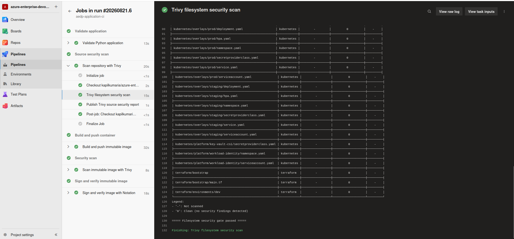
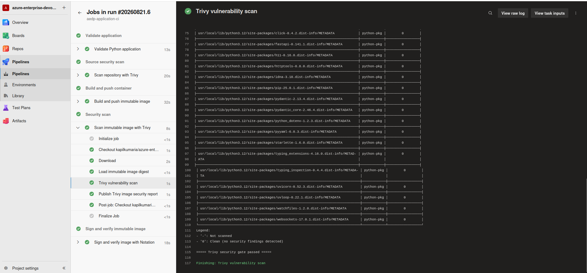
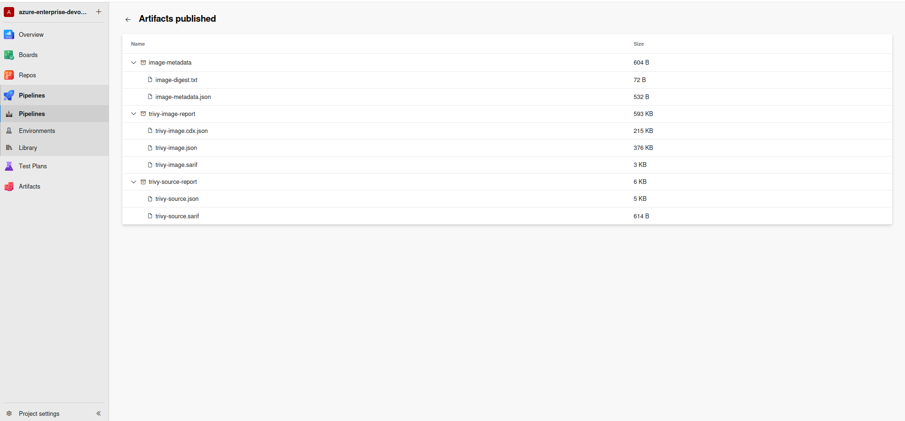
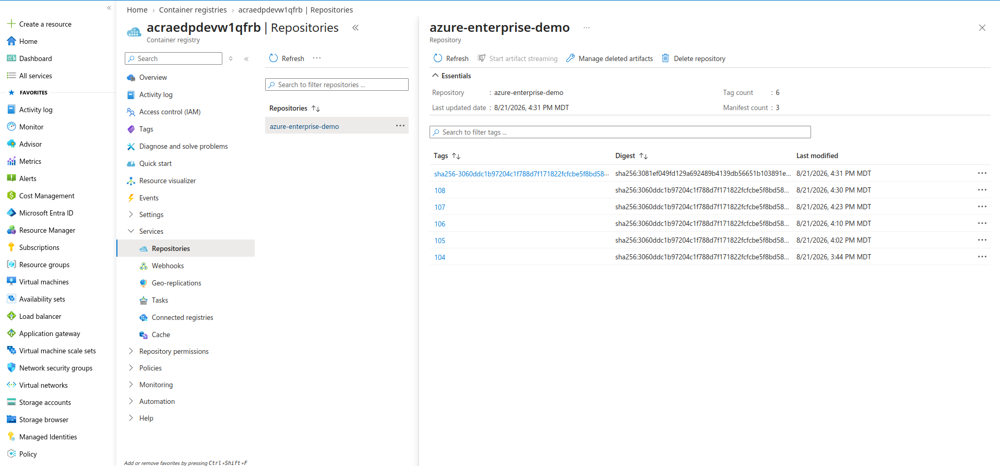
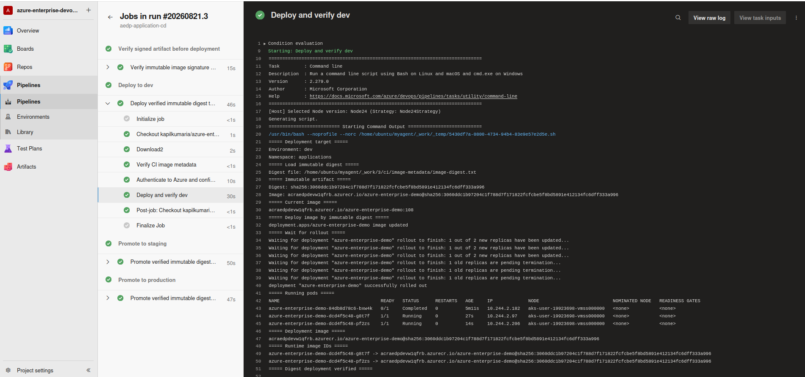
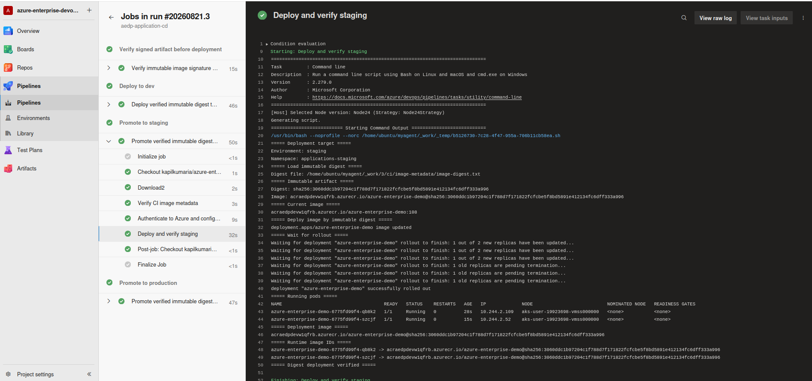
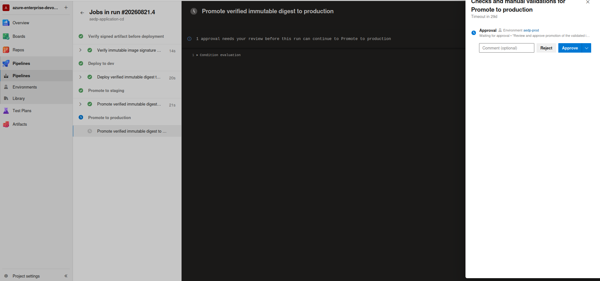
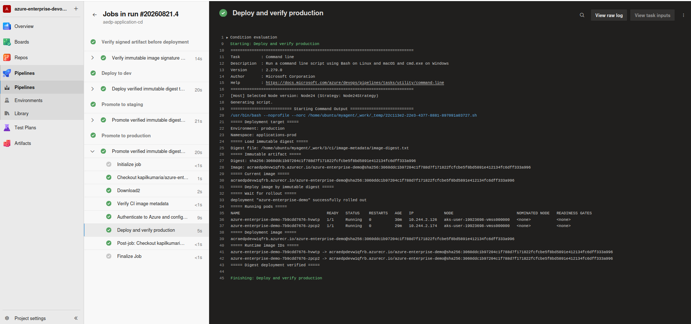

# Azure DevOps CI/CD Architecture

## Overview

The Azure Enterprise DevOps Platform uses Azure DevOps YAML pipelines to implement a reusable, security-aware CI/CD workflow for containerized applications deployed to Azure Kubernetes Service.

The delivery architecture separates Continuous Integration from Continuous Deployment.

The CI pipeline is responsible for validating application source, scanning the repository, building and scanning the container image, publishing the image to Azure Container Registry, resolving its immutable digest, signing the digest with Notation using an Azure Key Vault-backed signing key, verifying the signed artifact, and publishing machine-readable security evidence.

The CD pipeline consumes CI-produced image metadata, independently verifies the signed artifact, and promotes the same immutable image digest through Development, Staging, and Production.

The overall delivery flow is:

```text
Source Change
     |
     v
Azure DevOps CI
     |
     +--> Application Validation
     |
     +--> Trivy Filesystem Scan
     |
     +--> Docker Build
     |
     +--> Trivy Image Scan
     |
     +--> Push Image to ACR
     |
     +--> Resolve Immutable Image Digest
     |
     +--> Sign Digest with Notation
     |
     +--> Verify Signed Artifact
     |
     +--> Publish Security Evidence
     |
     v
Azure DevOps CD
     |
     +--> Validate CI Image Metadata
     |
     +--> Verify Signed Artifact
     |
     +--> Development
     |
     +--> Staging
     |
     +--> Production Approval
     |
     +--> Production
     |
     v
Azure Kubernetes Service
```

---

# Pipeline Design Principles

The pipeline architecture follows several engineering principles:

* Pipeline as Code
* reusable YAML templates
* immutable build artifacts
* shift-left security
* artifact promotion
* separation of CI and CD responsibilities
* environment-specific deployment configuration
* controlled production releases
* traceable security evidence
* repeatable deployment automation

The objective is to make application delivery reproducible and auditable rather than dependent on manual deployment procedures.

---

# Pipeline Repository Structure

Pipeline configuration is stored under:

```text
pipelines/
├── ci/
│   └── application-ci.yml
│
├── cd/
│   └── application-cd.yml
│
└── templates/
    ├── deploy-aks.yml
    ├── deploy-job.yml
    ├── docker-build-push.yml
    ├── notation-sign-verify.yml
    ├── notation-verify.yml
    ├── python-validate.yml
    ├── trivy-filesystem-scan.yml
    └── trivy-image-scan.yml
```

The top-level pipeline files describe workflow orchestration, while reusable templates encapsulate specific implementation responsibilities.

This avoids duplicating the same build, security, or deployment logic across multiple pipelines.

---

# CI Pipeline

The primary CI definition is:

```text
pipelines/ci/application-ci.yml
```

The CI pipeline converts application source code into a validated container artifact.

The logical execution sequence is:

```text
Repository
    |
    v
Application Validation
    |
    v
Trivy Filesystem Scan
    |
    v
Docker Build
    |
    v
Trivy Image Scan
    |
    v
Push Image to ACR
    |
    v
Resolve Immutable Image Digest
    |
    v
Notation Signing
    |
    v
Signature Verification
    |
    v
Security Evidence / Image Metadata
```


The individual stages solve different delivery risks.

---

# Application Validation

Application validation is performed before container image publication.

The reusable validation logic is located in:

```text
pipelines/templates/python-validate.yml

The validation stage prepares an isolated Python environment and verifies that the application source can be successfully compiled before later CI stages execute.

The implemented validation sequence is:

```text
Python Runtime Check
        |
        v
Create Virtual Environment
        |
        v
Upgrade pip
        |
        v
Install Application Dependencies
        |
        v
Compile Python Source
        |
        v
Validation Successful
```
The template performs the following checks and preparation steps:

- verifies the installed Python runtime;
- creates an isolated Python virtual environment;
- upgrades pip;
- installs application dependencies from the configured requirements file;
- validates Python source syntax and byte-code compilation using python -m compileall.

The pipeline uses set -euo pipefail, so a failure in dependency installation or source compilation causes the validation step to fail immediately.

This provides an early CI quality gate before container image creation and security scanning.

The current portfolio implementation focuses on dependency installation and Python compilation validation. Unit tests, integration tests, linting, and application startup tests would be natural extensions for a larger production application.

---

# Trivy Filesystem Scan

The reusable filesystem security scan is located in:

```text
pipelines/templates/trivy-filesystem-scan.yml
```

Trivy scans the source workspace before the final application image enters the deployment lifecycle.

This provides early detection of security concerns such as:

* vulnerable dependencies;
* known package vulnerabilities;
* configuration issues;
* exposed secrets where supported;
* infrastructure configuration problems.

The security model is intentionally shift-left.

Instead of waiting until deployment or production, the pipeline evaluates security during CI.

The flow is:

```text
Source Repository
      |
      v
Trivy Filesystem Scan
      |
      +--> Pass
      |      |
      |      v
      |   Continue Pipeline
      |
      +--> Fail
             |
             v
        Stop Pipeline
```



*Demonstrates shift-left source security validation.*

---

# Docker Image Build

Container image creation is handled through:

```text
pipelines/templates/docker-build-push.yml
```

The application Dockerfile is stored under:

```text
application/Dockerfile
```

The CI pipeline produces the container artifact that will eventually be deployed to AKS.

The build process follows the principle that deployment environments should consume a known artifact rather than rebuilding an unrelated image for every environment.

Conceptually:

```text
Application Source
      |
      v
Docker Build
      |
      v
Versioned Image
      |
      v
Security Validation
      |
      v
ACR
```

---

# Trivy Container Image Scan

The built container image is scanned through:

```text
pipelines/templates/trivy-image-scan.yml
```

Filesystem scanning and image scanning are deliberately separate controls.

Filesystem scanning evaluates repository content.

Image scanning evaluates the actual container artifact, including operating-system packages and application dependencies included during the Docker build.

This is important because the final image may contain vulnerabilities that are not obvious from the original application source.

The security gate therefore occurs before the image is accepted for deployment.

```text
Docker Image
     |
     v
Trivy Image Scan
     |
     +--> Acceptable
     |      |
     |      v
     |    Publish
     |
     +--> Security Gate Failure
            |
            v
        Stop Pipeline
```



*Demonstrates the final deployable artifact is security scanned.*

---

# Security Report Publication

Security results are retained as pipeline artifacts.

The implementation publishes machine-readable security evidence including:

* JSON;
* SARIF.

This is important because a security scan should not merely print information to a console and disappear.

Publishing reports allows:

* later investigation;
* pipeline auditability;
* security review;
* artifact retention;
* integration with downstream security tooling;
* historical comparison.

The conceptual flow is:

```text
Trivy
  |
  +--> Console Output
  |
  +--> JSON Report
  |
  +--> SARIF Report
          |
          v
Azure DevOps Pipeline Artifacts
```



*Demonstrates retained and auditable security evidence.*

---

# Azure Container Registry

After successful validation and security checks, the container artifact is published to Azure Container Registry.

ACR becomes the trusted image repository for the platform.

The artifact path is:

```text
CI
 |
 v
Validated Container Image
 |
 v
Azure Container Registry
 |
 v
AKS
```

AKS obtains registry access through Azure RBAC.

This removes the need to embed static Docker registry credentials in Kubernetes application configuration.



*Demonstrate artifact publication and versioning.*

---

# Immutable Artifact Promotion

An important delivery principle is that Staging and Production should receive the same container artifact that was previously validated.

The preferred model is:

```text
Build Once
    |
    v
Push Image to ACR
    |
    v
Resolve Immutable Digest
    |
    v
Sign Digest with Notation
    |
    v
sha256:<digest>
    |
    +--> Development
    |
    +--> Staging
    |
    +--> Production
```

rather than:

```text
Dev Build
Staging Build
Production Build
```

Rebuilding separately for every environment introduces the possibility that Production receives an artifact that differs from the one tested in Staging.

Digest-based promotion ensures that Development, Staging, and Production reference the same immutable container artifact rather than independently rebuilt or mutable tag-only artifacts.

---

# CD Pipeline

The primary CD definition is:

```text
pipelines/cd/application-cd.yml
```

The CD pipeline deploys the validated application artifact to AKS.

The logical release path is:

```text
ACR
 |
 v
Development
 |
 v
Staging
 |
 v
Production Approval
 |
 v
Production
```

Each stage represents a progressively stronger deployment boundary.

---

# Reusable Deployment Templates

Deployment behavior is encapsulated through reusable templates including:

```text
pipelines/templates/deploy-job.yml
pipelines/templates/deploy-aks.yml
```

These templates allow the pipeline to reuse the same deployment mechanics while providing environment-specific parameters.

Benefits include:

* reduced YAML duplication;
* consistent deployment behavior;
* easier maintenance;
* centralized fixes;
* standardized deployment controls.

Without reusable templates, every environment would require duplicated deployment logic, increasing the risk of configuration drift.

---

# Kubernetes Deployment Model

The CD pipeline deploys Kubernetes configuration using reusable base resources together with explicit environment-specific configuration where required.

```text
kubernetes/
├── base/
│   └── application/
│
├── overlays/
│   ├── staging/
│   └── prod/
│
└── platform/
    ├── key-vault-csi/
    └── workload-identity/
```

Development consumes the reusable application base together with shared platform resources.

Staging and Production use explicit environment-specific overlays containing their Namespace, ServiceAccount, SecretProviderClass, Deployment, Service, HPA, and Kustomize configuration.

The environments are logically separated through Azure DevOps environments, Kubernetes namespaces, environment-specific ServiceAccounts, federated identity credentials, and controlled CI/CD promotion.

---

# Development Deployment

Development is the first deployment target.

The purpose of the Development stage is to:

* verify successful Kubernetes deployment;
* confirm image availability;
* validate configuration;
* validate Key Vault integration;
* confirm Workload Identity;
* perform early runtime testing.

The deployment should fail immediately if the workload cannot successfully reach a healthy state.



*Demonstrates automatic lower-environment deployment.*

---

# Staging Deployment

Staging provides the pre-production validation boundary.

The application artifact promoted to Staging should be the same artifact previously validated in Development.

Staging allows validation of:

* deployment configuration;
* runtime behavior;
* environment-specific configuration;
* secret access;
* Kubernetes health;
* autoscaling resources;
* production-like release behavior.



*Demonstrates controlled application promotion.*

---

# Production Approval

Production is intentionally protected by an approval boundary.

The release path is:

```text
Staging Successful
       |
       v
Production Approval
       |
       +--> Rejected
       |       |
       |       v
       |   Deployment Stops
       |
       +--> Approved
               |
               v
          Production
```

This represents a governance control rather than a technical deployment requirement.

The approval boundary allows an organization to enforce additional controls before production deployment.

Examples in a real enterprise environment could include:

* release manager approval;
* change ticket validation;
* security review;
* maintenance windows;
* business approval;
* separation of duties.



*Demonstrates Production release governance.*

---

# Production Deployment

After approval, the validated artifact is deployed into the Production application environment.

Production configuration uses its environment-specific Kubernetes overlay and ServiceAccount configuration.

The production stage represents the final destination in the application's delivery lifecycle.



*Demonstrates complete Dev -> Staging -> Production delivery.*

---

# Deployment Validation

A deployment pipeline should not consider a Kubernetes command successful merely because `kubectl apply` returned successfully.

The deployment process should validate workload health.

Typical validation mechanisms include:

```bash
kubectl rollout status deployment/<deployment> -n <namespace>
```

and:

```bash
kubectl get pods -n <namespace>
```

The distinction is important:

```text
kubectl apply successful
        !=
Application healthy
```

A mature CD process verifies the runtime state after applying Kubernetes configuration.

---

# Environment Strategy

The portfolio platform models three logical application environments inside the AKS platform:

```text
AKS
├── Development
├── Staging
└── Production
```

The environments are logically separated through a combination of:
>
> * Kubernetes namespaces;
> * Azure DevOps environments;
> * environment-specific Kubernetes configuration;
> * environment-specific ServiceAccounts;
> * federated identity credentials;
> * controlled CI/CD promotion.

> Development uses the reusable application base and shared platform resources, while Staging and Production use explicit environment-specific Kustomize overlays.

This implementation provides logical environment isolation while remaining cost-efficient for a portfolio platform.

For a production enterprise architecture, stronger isolation may be achieved through:

* separate AKS clusters;
* separate Azure subscriptions;
* separate VNets;
* independent identities;
* separate Key Vault instances;
* independent CI/CD service connections.

The correct level of isolation depends on security, compliance, blast-radius, availability, and cost requirements.

---

# Self-Hosted Azure DevOps Agent

Pipeline execution is performed using a self-hosted Azure DevOps agent hosted on AWS EC2.

The execution architecture is:

```text
Azure DevOps Control Plane
          |
          | Assign Pipeline Job
          v
AWS EC2 Self-Hosted Agent
          |
          +--> Git
          +--> Terraform
          +--> Azure CLI
          +--> Docker
          +--> kubectl
          +--> Trivy
          |
          v
Azure Platform
```

Azure DevOps coordinates the workflow but the job itself executes on the registered agent.

This demonstrates an important architectural property:

Azure DevOps pipeline agents do not have to run inside Microsoft Azure.

The build worker is infrastructure-independent as long as it can:

* connect to Azure DevOps;
* authenticate to required cloud services;
* execute the required tooling;
* reach target infrastructure.

---

# Why Use a Self-Hosted Agent?

A self-hosted agent provides greater control over:

* installed tools;
* Docker availability;
* Terraform versions;
* Azure CLI versions;
* kubectl;
* security scanning tools;
* build caching;
* network connectivity.

It can also be useful where target resources are reachable only from controlled networks.

The trade-off is operational ownership.

With a self-hosted agent, the platform team is responsible for:

* patching;
* security;
* agent availability;
* tool maintenance;
* scaling;
* credentials;
* operating-system lifecycle.

For larger production environments, dynamically provisioned or autoscaled agents would generally be preferable to a single persistent VM.

---

# Pipeline Authentication

The CI/CD platform needs authenticated access to resources such as:

* Azure;
* Azure Container Registry;
* Azure Kubernetes Service.

Credentials and identity permissions should be scoped according to least privilege.

Static credentials should not be embedded directly in pipeline YAML.

Production implementations should prefer mechanisms such as:

* Azure DevOps service connections;
* workload identity federation;
* managed identity where applicable;
* protected variable groups;
* Key Vault integration.

---

# CI/CD Security Boundaries

Several security boundaries exist in the delivery system.

```text
Developer
   |
   v
Git Repository
   |
   v
Azure DevOps
   |
   v
Self-Hosted Agent
   |
   +--> ACR
   |
   +--> AKS
   |
   +--> Azure APIs
```

Each boundary must be authenticated and authorized.

The self-hosted agent is particularly security-sensitive because it executes pipeline code and can interact with deployment infrastructure.

For production, the agent should therefore be:

* hardened;
* patched;
* access-controlled;
* monitored;
* isolated from unnecessary workloads;
* assigned least-privilege credentials.

---

# Pipeline Security Gates

The pipeline implements security as a release decision rather than only as informational reporting.

The desired model is:

```text
Security Scan
      |
      +--> Policy Satisfied
      |        |
      |        v
      |    Continue
      |
      +--> Policy Violated
               |
               v
          Fail Pipeline
```

This prevents known unacceptable vulnerabilities from automatically progressing toward deployment.

The exact severity threshold can be adjusted according to organizational risk policy.

---

# Pipeline Failure Strategy

A failure in an early pipeline stage should stop downstream release activity.

Examples include:

```text
Application Validation Failure
        |
        v
No Image Build
```

```text
Trivy Security Failure
        |
        v
No Trusted Image Promotion
```

```text
Development Deployment Failure
        |
        v
No Staging Promotion
```

```text
Staging Failure
        |
        v
No Production Deployment
```

This implements fail-fast behavior and reduces the probability that a known-bad release reaches Production.

---

# Traceability

A mature CI/CD system should provide traceability between:

```text
Source Commit
      |
      v
Pipeline Run
      |
      v
Container Image
      |
      v
Deployment
      |
      v
Environment
```

Immutable image digests, pipeline metadata, and source revision information provide the basis for tracing a deployed artifact back through its CI/CD lifecycle.

Then show:

```text
Source Commit
      |
      v
CI Pipeline Run
      |
      v
ACR Image Digest
      |
      v
Notation Signature
      |
      v
CD Pipeline Run
      |
      v
AKS Environment
```
---

# Rollback Strategy

The intended rollback model is artifact-based, using a previously validated immutable image digest retained in ACR.

Because previous image versions remain available in the container registry, a problematic release can be replaced with a previously validated image.

Conceptually:

```text
Production
   |
   | New release unhealthy
   v
Select Previous Validated Image Digest
   |
   v
Redeploy
   |
   v
Validate Rollout
```

For more advanced production environments, deployment strategies could include:

* rolling deployment;
* blue/green deployment;
* canary release;
* progressive delivery.

The appropriate strategy depends on application criticality and traffic architecture.

---

# Supply Chain Security

The CI/CD implementation includes container artifact signing and verification using Notation.

The relevant reusable templates are:

```text
pipelines/templates/notation-sign-verify.yml
pipelines/templates/notation-verify.yml
```
The CI pipeline resolves the immutable ACR image digest and signs that artifact using Notation with an Azure Key Vault-backed signing key.

The signing flow is:

```text
Container Image
      |
      v
Push to ACR
      |
      v
Resolve Immutable Digest
      |
      v
Notation Signing
      |
      v
Signed ACR Artifact
      |
      v
Signature Verification
```
The CD pipeline independently verifies the signed artifact before deployment.

This provides an artifact-integrity and authenticity control in addition to vulnerability scanning. Deployment therefore operates on an immutable, signed image reference rather than relying solely on a mutable container tag.

The implementation could be extended further in a production environment through:

> - Software Bill of Materials generation;
> - SLSA-aligned build provenance;
> - artifact attestations;
> - Kubernetes admission-time signature enforcement;
> - organization-wide artifact trust policies.

---

# Pipeline Observability

Pipeline execution itself should be treated as an observable system.

Useful operational information includes:

* pipeline duration;
* stage failure rate;
* deployment frequency;
* lead time;
* failed deployment rate;
* security gate failures;
* production deployment success rate.

In a mature engineering organization, these measurements can contribute to delivery-performance metrics such as DORA metrics.

---

# End-to-End CI/CD Flow

The complete delivery sequence is:

```text
Developer Change
      |
      v
Git Repository
      |
      v
Azure DevOps CI
      |
      +--> Python Validation
      |
      +--> Trivy Filesystem Scan
      |
      +--> Docker Build
      |
      +--> Trivy Image Scan
      |
      +--> Push Image to ACR
      |
      +--> Resolve Immutable Image Digest
      |
      +--> Sign Digest with Notation
      |
      +--> Verify Signed Artifact
      |
      +--> Publish JSON / SARIF Security Evidence
      |
      v
Azure DevOps CD
      |
      +--> Validate CI Image Metadata
      |
      +--> Verify Signed Artifact
      |
      +--> Deploy Development
      |
      +--> Validate Development
      |
      +--> Deploy Staging
      |
      +--> Validate Staging
      |
      +--> Production Approval
      |
      +--> Deploy Production
      |
      v
Azure Kubernetes Service
      |
      +--> Workload Identity
      +--> Azure Key Vault
      +--> HPA
      +--> Azure Monitor
```
---

# Evidence to Capture

The final repository should include evidence of:

1. successful CI pipeline;
2. application validation;
3. Trivy filesystem scan;
4. Trivy image scan;
5. security report artifacts;
6. application image in ACR;
7. successful Development deployment;
8. successful Staging deployment;
9. Production approval;
10. successful Production deployment.

The screenshots should be treated as technical evidence rather than decorative images.

---

# Production Enhancements

Potential production improvements include:

* ephemeral self-hosted build agents;
* agent autoscaling;
* private agent networking;
* dedicated agent pools per trust boundary;
* workload identity federation for Azure DevOps;
* mandatory artifact signing;
* SBOM generation;
* provenance attestations;
* policy-as-code security gates;
* automated integration testing;
* automated smoke testing;
* canary deployment;
* blue/green deployment;
* automated rollback;
* deployment metrics;
* DORA metrics;
* stronger separation of deployment permissions between environments.

These improvements should be selected based on organizational requirements rather than added purely for complexity.

---

# Key Engineering Takeaways

The CI/CD implementation demonstrates several platform engineering concepts:

* build once and promote the same artifact;
* security checks belong inside CI;
* security evidence should be retained;
* deployment logic should be reusable;
* lower environments should validate releases before Production;
* production deployments should have an explicit governance boundary;
* pipeline agents are execution infrastructure and require security controls;
* successful manifest application is not equivalent to successful application deployment;
* CI and CD should fail fast when required quality or security gates are not satisfied.

The objective of the delivery architecture is not merely automation.

The objective is to create a controlled, repeatable, secure, and observable path from source code to Production.

