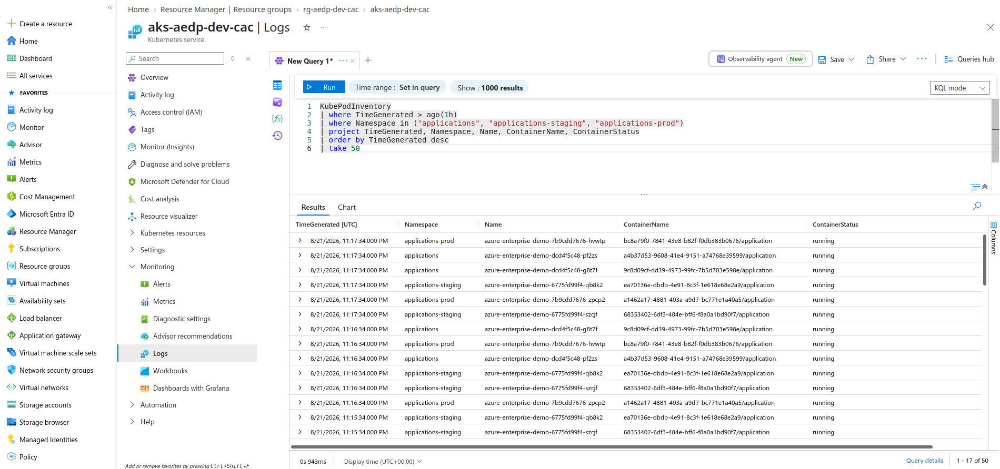
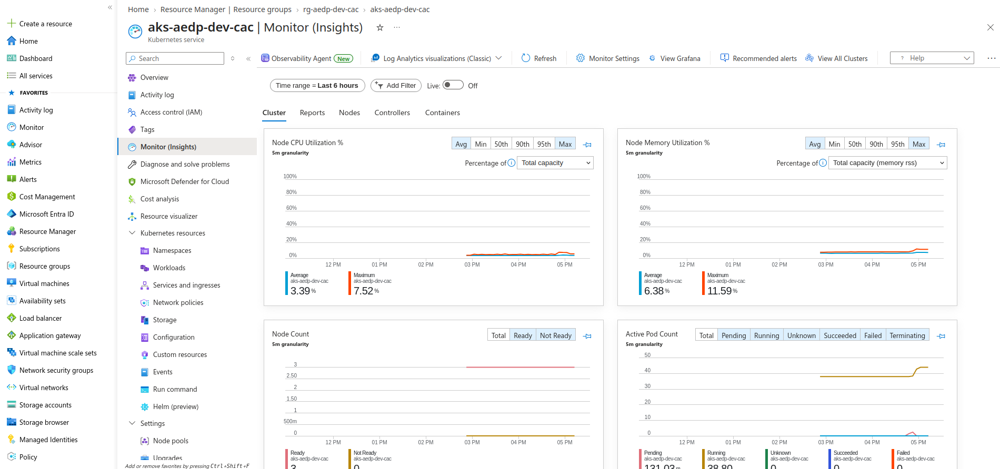
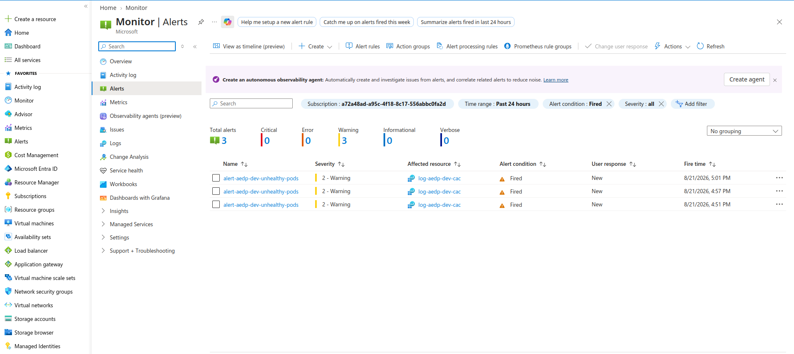
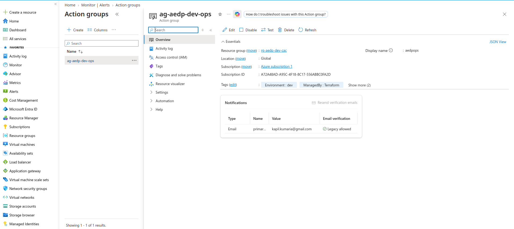
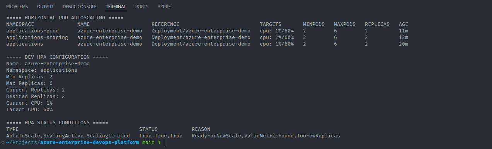

# Observability and Monitoring Architecture

## Overview

The Azure Enterprise DevOps Platform uses Azure-native observability services to provide visibility into the health, performance, and operational state of Azure Kubernetes Service and the applications running on it.

The monitoring architecture combines:

* Azure Monitor
* Log Analytics
* Container Insights
* Data Collection Rules
* AKS diagnostic settings
* scheduled query alert rules
* Azure Monitor Action Groups
* Kubernetes resource metrics
* Horizontal Pod Autoscaler telemetry
* AKS node and workload health information

The objective is not simply to collect logs.

The platform is designed to support three operational functions:

```text
Observe
   |
   v
Investigate
   |
   v
Alert
```

This allows engineers to understand current platform behavior, investigate failures, and receive proactive notification when defined unhealthy conditions occur.

---

# Observability Design Principles

The monitoring implementation follows several principles:

* centralized telemetry;
* infrastructure-defined monitoring;
* proactive alerting;
* workload and platform visibility;
* actionable signals;
* reproducible configuration;
* separation of collection and alerting;
* operational troubleshooting through queryable data.

Monitoring resources are provisioned through Terraform so observability is part of the platform rather than a manual post-deployment activity.

---

# Monitoring Architecture

The logical telemetry flow is:

```text
AKS Cluster
    |
    +--> Kubernetes workloads
    |
    +--> Node telemetry
    |
    +--> Container telemetry
    |
    +--> Control-plane diagnostics
    |
    v
Data Collection / Diagnostic Configuration
    |
    v
Log Analytics Workspace
    |
    +--> Operational Queries
    |
    +--> Container Insights
    |
    v
Azure Monitor
    |
    v
Scheduled Query Alert
    |
    v
Action Group
```

This creates a path from workload state to operational response.

---

# Terraform Monitoring Module

Monitoring infrastructure is managed through:

```text
terraform/modules/monitoring/
├── main.tf
├── outputs.tf
└── variables.tf
```

The module provisions the monitoring components required by the AKS platform.

Resources include:

* Log Analytics Workspace;
* Data Collection Rule;
* Data Collection Rule association;
* AKS diagnostic settings;
* Azure Monitor scheduled query alert;
* Azure Monitor Action Group.

This ensures that rebuilding the platform also rebuilds its monitoring configuration.

---

# Log Analytics Workspace

The Log Analytics Workspace acts as the centralized telemetry store for the Azure environment.

It provides a queryable location for operational data collected from AKS and associated Azure services.

The logical architecture is:

```text
AKS
 |
 +--> Logs
 +--> Metrics-related telemetry
 +--> Kubernetes resource information
 +--> Diagnostic events
 |
 v
Log Analytics Workspace
```

Centralization improves troubleshooting because engineers do not need to investigate isolated node-level log files individually.

---

# Why Centralized Logging Matters

Without centralized logging, investigation may require engineers to:

* connect to individual machines;
* inspect local logs;
* correlate timestamps manually;
* search multiple systems independently.

With centralized telemetry:

```text
Multiple Workloads
       |
       v
Central Workspace
       |
       v
Single Query Interface
```

This significantly improves operational investigation.

---

# Kusto Query Language

Log Analytics data can be investigated using Kusto Query Language.

KQL allows engineers to filter, aggregate, correlate, and analyze Azure and Kubernetes telemetry.

Typical operational questions include:

* Which pods are failing?
* Which namespaces have unhealthy workloads?
* When did failures begin?
* Which container generated an error?
* Are failures concentrated on a specific node?
* Is a condition recurring?
* Did application behavior change after deployment?



*Demonstrate query-driven operational troubleshooting.*

---

# Container Insights

Container Insights provides Kubernetes-specific monitoring for AKS.

It provides visibility into resources such as:

* clusters;
* nodes;
* controllers;
* pods;
* containers.

This allows platform engineers to inspect infrastructure and workload health without relying only on command-line inspection.

The relationship is:

```text
AKS
 |
 v
Container Insights
 |
 +--> Node health
 +--> Pod health
 +--> Controller information
 +--> Container telemetry
```



*Demonstrate Azure-native Kubernetes observability.*

---

# Data Collection Rule

Azure Monitor Data Collection Rules define how supported telemetry is collected and routed.

The platform provisions a DCR through Terraform and associates it with AKS.

Conceptually:

```text
AKS
 |
 v
Data Collection Rule
 |
 v
Log Analytics Workspace
```

Managing this through Terraform ensures telemetry collection behavior is reproducible.

---

# Data Collection Rule Association

Creating a Data Collection Rule alone is insufficient.

The rule must be associated with the target resource.

The platform therefore provisions the DCR association linking the monitoring rule to AKS.

This distinction is important:

```text
DCR Exists
    !=
AKS Using DCR
```

The association activates the relationship between the cluster and telemetry configuration.

---

# AKS Diagnostic Settings

AKS control-plane and platform diagnostics are configured through Azure Monitor diagnostic settings.

Diagnostic settings provide a mechanism to route selected Azure resource logs to supported destinations such as Log Analytics.

Conceptually:

```text
AKS Platform
     |
     v
Diagnostic Settings
     |
     v
Log Analytics
```

This complements workload-level observability by providing visibility into Azure-managed platform activity.

---

# Workload Monitoring

Monitoring must include application workloads, not just the Kubernetes cluster itself.

The platform therefore considers signals associated with:

* Deployment health;
* Pod status;
* container state;
* restart behavior;
* resource utilization;
* replica count;
* autoscaling behavior.

A cluster can be technically available while an application running inside it is unhealthy.

Therefore:

```text
Cluster Healthy
      !=
Application Healthy
```

Both platform and workload signals matter.

---

# Kubernetes Operational Validation

Command-line validation remains useful alongside Azure-native monitoring.

Examples include:

```bash
kubectl get pods -A
```

```bash
kubectl get deployments -A
```

```bash
kubectl get hpa -A
```

```bash
kubectl top nodes
```

```bash
kubectl top pods -A
```

These commands provide immediate runtime visibility and complement centralized monitoring.

---

# Azure Monitor Alerting

Monitoring becomes operationally useful when important conditions can generate alerts.

The platform provisions an Azure Monitor scheduled query alert.

The purpose is to detect unhealthy application pod conditions based on telemetry stored in Log Analytics.

The logical path is:

```text
Application Condition
       |
       v
Telemetry
       |
       v
Log Analytics
       |
       v
Scheduled Query
       |
       +--> Healthy
       |      |
       |      v
       |   No Alert
       |
       +--> Unhealthy
              |
              v
         Azure Monitor Alert
```



*Demonstrate proactive workload monitoring.*

---

# Scheduled Query Alerts

A scheduled query alert periodically evaluates a KQL query.

Instead of requiring an operator to continuously inspect logs manually, Azure Monitor evaluates the defined condition automatically.

Conceptually:

```text
KQL Query
   |
   | every evaluation interval
   v
Condition Evaluation
   |
   +--> False
   |
   +--> True
          |
          v
        Alert
```

This converts observability data into an actionable operational signal.

---

# Action Groups

An Azure Monitor Action Group defines what should happen after an alert is triggered.

The architecture is:

```text
Alert Rule
    |
    v
Action Group
    |
    +--> Notification
    +--> Automation
    +--> External Integration
```

Depending on organizational requirements, Action Groups can integrate with notification and automation mechanisms.

The project provisions the Action Group through Terraform.



*Demonstrate alert notification architecture.*

---

# Monitoring as Infrastructure as Code

Observability configuration is provisioned with Terraform.

This is important because monitoring should not rely on manual portal configuration that disappears when the environment is recreated.

The lifecycle becomes:

```text
Terraform
   |
   v
AKS
   +
Log Analytics
   +
DCR
   +
Diagnostic Settings
   +
Alerts
   +
Action Group
```

The infrastructure and its monitoring controls therefore evolve together.

---

# Autoscaling Observability

The platform implements multiple scaling layers.

## Horizontal Pod Autoscaler

The Kubernetes HPA adjusts application replica count according to configured metrics.

Operationally, engineers should be able to inspect:

```bash
kubectl get hpa -A
```

The HPA provides visibility into:

* current replicas;
* desired replicas;
* metric targets;
* observed utilization.



*Demonstrate application autoscaling and operational visibility.*

---

# Cluster Autoscaler

The AKS node pools support cluster autoscaling.

The relationship between the scaling mechanisms is:

```text
Application Load
      |
      v
HPA
      |
      v
Additional Pods
      |
      v
Insufficient Capacity?
      |
      v
AKS Cluster Autoscaler
      |
      v
Additional Nodes
```

HPA and cluster autoscaling solve different resource problems.

HPA scales workloads.

Cluster Autoscaler scales infrastructure capacity.

---

# Monitoring Scaling Events

Useful scaling-related signals include:

* replica count;
* HPA target utilization;
* pending pods;
* node utilization;
* node count;
* scheduling failures;
* container resource pressure.

A production monitoring strategy should detect situations where scaling is requested but infrastructure cannot satisfy demand.

---

# Resource Requests and Limits

Autoscaling and scheduler behavior depend on accurate Kubernetes resource configuration.

Requests help Kubernetes determine placement and capacity requirements.

Limits help control maximum resource consumption.

Poor resource settings can create misleading autoscaling behavior.

For example:

```text
Incorrect CPU Requests
       |
       v
Misleading HPA Utilization
       |
       v
Unexpected Scaling
```

Monitoring therefore helps validate whether resource policies are operating as intended.

---

# Application Health Versus Infrastructure Health

A mature monitoring system distinguishes several failure domains.

```text
Azure Platform
      |
      v
AKS Cluster
      |
      v
Kubernetes Node
      |
      v
Pod
      |
      v
Container
      |
      v
Application
```

A failure may occur at any one of these layers.

For example:

* Azure resource unavailable;
* node unhealthy;
* pod unschedulable;
* container crash loop;
* application returns errors.

Observability should help engineers determine which layer is responsible.

---

# Deployment Monitoring

CI/CD deployment validation should be connected conceptually to operational monitoring.

A deployment flow should not end with:

```text
kubectl apply
```

Instead:

```text
Deployment
    |
    v
Rollout Validation
    |
    v
Application Health
    |
    v
Monitoring
```

A release is not operationally successful merely because Kubernetes accepted the manifest.

---

# Alert Quality

Alerts should be actionable.

Poor alert design creates excessive noise and eventually causes operators to ignore notifications.

Useful alerting should consider:

* severity;
* duration;
* business impact;
* recurrence;
* threshold;
* routing.

The goal is:

```text
Meaningful Condition
       |
       v
Actionable Alert
```

rather than:

```text
Every Minor Event
       |
       v
Alert Storm
```

---

# Operational Troubleshooting Workflow

A typical investigation may follow:

```text
Alert Received
     |
     v
Determine Scope
     |
     v
Inspect AKS / Workload State
     |
     v
Query Log Analytics
     |
     v
Identify Failure Domain
     |
     v
Remediate
     |
     v
Validate Recovery
```

This workflow combines alerting, Kubernetes commands, Azure monitoring, and centralized logs.

---

# Example Failure Scenario

Consider an application whose pods begin failing.

The operational path could be:

```text
Pod Failures
    |
    v
Telemetry Collected
    |
    v
Log Analytics
    |
    v
Scheduled Query Alert
    |
    v
Action Group
    |
    v
Engineer Investigation
```

The engineer can then correlate:

```bash
kubectl get pods -n <namespace>
```

with Log Analytics telemetry to determine the failure cause.

---

# Controlled Monitoring Validation

Monitoring configuration should be tested rather than assumed to work.

A controlled failure can be introduced into a non-production workload.

For example:

```text
Temporary Invalid Deployment
        |
        v
Pod Becomes Unhealthy
        |
        v
Telemetry Captured
        |
        v
Alert Condition Evaluated
        |
        v
Alert Confirmed
```

After validation, the workload should be restored immediately.

This proves the complete observability path rather than only verifying that Terraform created an alert resource.

---

# Evidence to Capture

The final portfolio evidence should demonstrate:

1. AKS Container Insights;
2. Log Analytics query returning AKS information;
3. Azure Monitor scheduled query alert;
4. Azure Monitor Action Group;
5. Kubernetes HPA state;
6. healthy cluster/workload state.

The strongest screenshots are those that demonstrate an operational capability rather than merely showing that a resource exists.

---

# Monitoring Screenshot Safety

Monitoring screenshots should be reviewed before committing.

Avoid exposing:

* subscription identifiers where unnecessary;
* email addresses;
* notification endpoints;
* authentication information;
* sensitive application logs;
* secret values;
* customer or personal data.

Crop or redact screenshots when required.

---

# Production Monitoring Enhancements

A production platform could extend the current implementation with:

* Application Insights;
* OpenTelemetry;
* distributed tracing;
* custom application metrics;
* Prometheus metrics;
* managed Prometheus;
* Grafana;
* SLOs;
* SLIs;
* error-budget monitoring;
* synthetic monitoring;
* external availability probes;
* centralized dashboards;
* Microsoft Sentinel integration;
* incident-management integration;
* on-call escalation;
* long-term telemetry retention;
* cost-monitoring dashboards.

The appropriate observability stack depends on application architecture, operational maturity, compliance, and cost.

---

# SLI and SLO Evolution

A mature platform should evolve from infrastructure monitoring toward service-level monitoring.

For example:

```text
Infrastructure Metric
CPU Utilization
       |
       v
Application Metric
Request Error Rate
       |
       v
Service-Level Indicator
Successful Request Percentage
       |
       v
Service-Level Objective
99.9% Successful Requests
```

This shifts monitoring toward user-visible reliability rather than only infrastructure status.

---

# DORA and Delivery Observability

Operational telemetry can also complement software delivery metrics.

Examples include:

* deployment frequency;
* deployment failure rate;
* mean time to recovery;
* lead time for changes.

Combining CI/CD data with production observability can help engineering teams understand both delivery speed and reliability.

---

# Monitoring Responsibilities

In a real organization, monitoring responsibilities are shared.

## Platform Team

Typically responsible for:

* AKS monitoring foundation;
* Log Analytics;
* cluster telemetry;
* alert infrastructure;
* monitoring integrations.

## Application Team

Typically responsible for:

* application-specific metrics;
* service-level alerts;
* application dashboards;
* application SLOs.

## SRE / Operations

May be responsible for:

* alert quality;
* incident response;
* reliability engineering;
* operational readiness;
* escalation paths.

The platform should provide common capabilities while allowing application teams to define service-specific signals.

---

# Observability Maturity Model

The platform demonstrates several stages of monitoring maturity:

```text
Stage 1
Can I see the resource?

Stage 2
Can I see workload health?

Stage 3
Can I query historical telemetry?

Stage 4
Can unhealthy conditions alert automatically?

Stage 5
Can I measure service reliability?

Stage 6
Can I automate operational response?
```

The project primarily implements Stages 1 through 4 and establishes a foundation for more advanced reliability practices.

---

# Key Monitoring Takeaways

The monitoring architecture demonstrates several important principles.

First, observability is part of platform engineering.

It should be provisioned together with the infrastructure.

Second, collecting data and generating alerts are different responsibilities.

Log Analytics stores and exposes telemetry, while Azure Monitor evaluates operational conditions.

Third, Kubernetes health exists at multiple layers.

Cluster availability alone does not prove application health.

Fourth, autoscaling requires observability.

Engineers need visibility into pods, nodes, resource utilization, and scaling decisions.

Finally, monitoring should lead to action.

The target operating model is:

```text
Collect
   |
   v
Understand
   |
   v
Detect
   |
   v
Respond
   |
   v
Recover
```

The objective is not simply to create dashboards.

The objective is to enable engineers to detect problems quickly, identify their cause, and restore healthy service operation.

