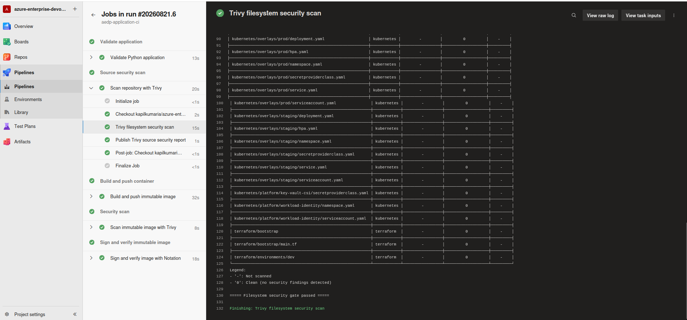
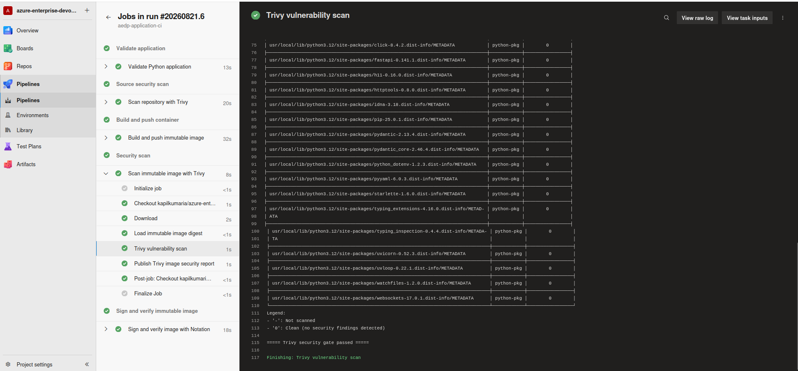
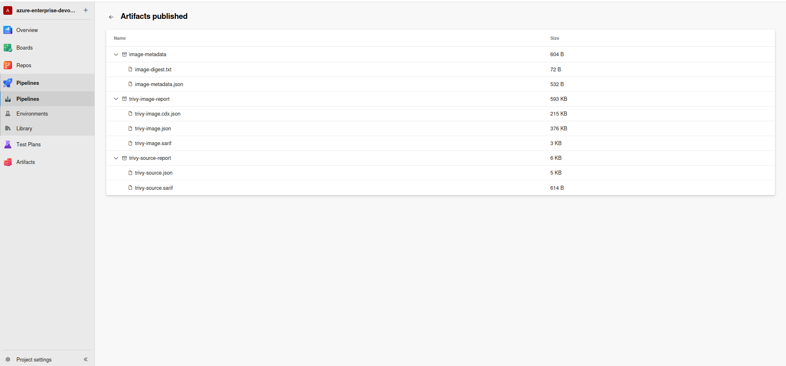
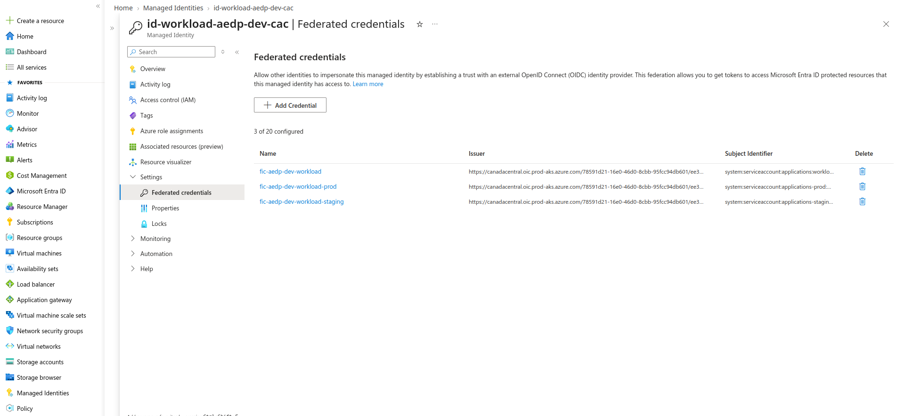
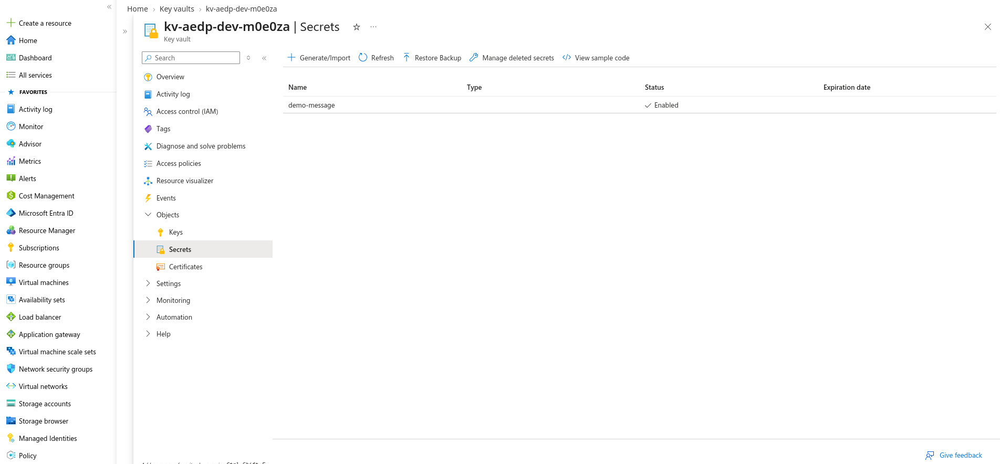
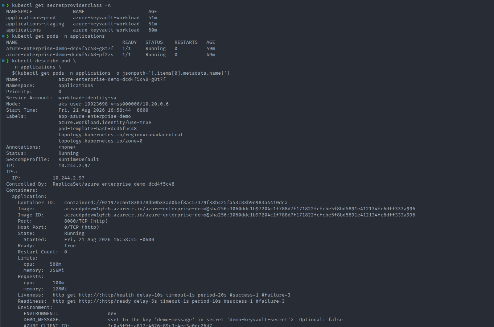
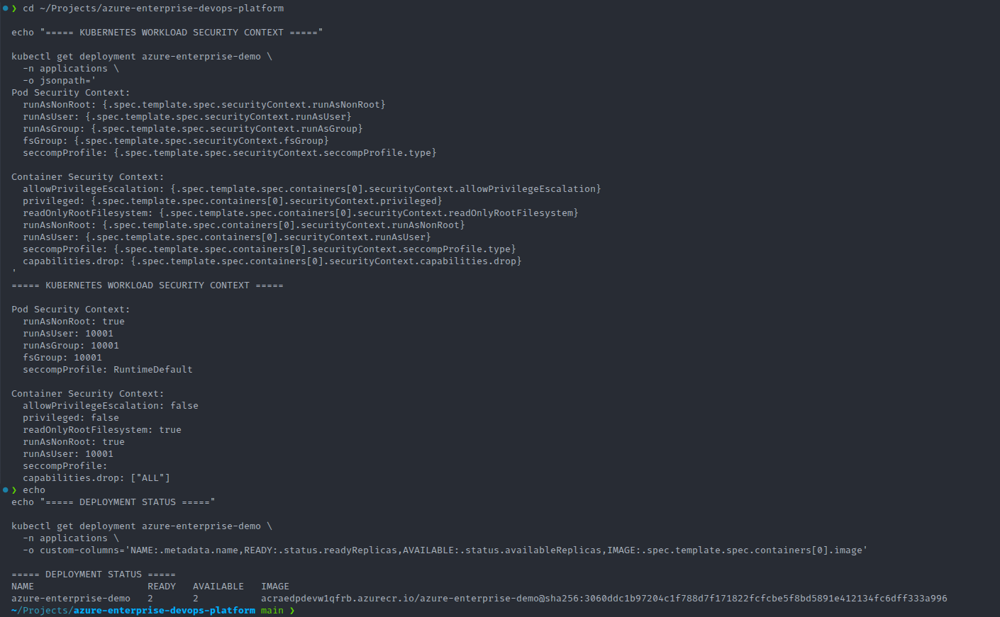
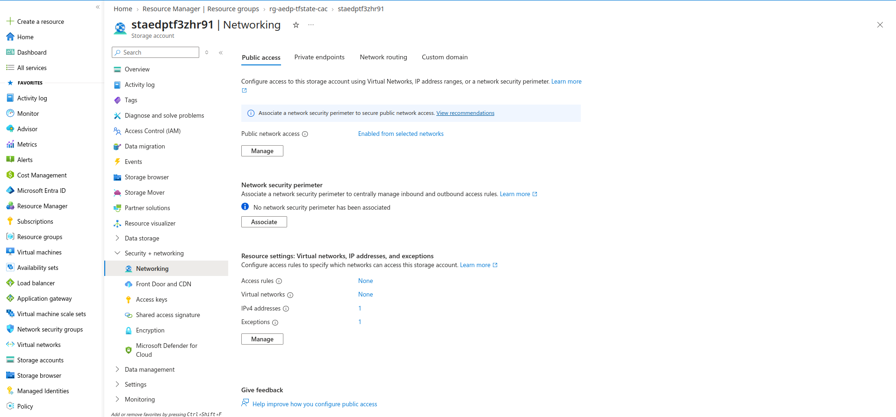

# Security and DevSecOps Architecture

## Overview

Security is implemented throughout the Azure Enterprise DevOps Platform rather than being treated as a single control applied at the end of the delivery process.

The security architecture covers:

* source-code security scanning;
* container image vulnerability scanning;
* pipeline security gates;
* security evidence retention;
* Azure RBAC;
* AKS identity separation;
* Microsoft Entra Workload Identity;
* OIDC federation;
* Azure Key Vault;
* Secrets Store CSI integration;
* Kubernetes workload hardening;
* Terraform state protection;
* Terraform backend network restrictions;
* source-control secret protection;
* controlled production promotion.

The overall strategy follows defense in depth.

```text
Source Code
    |
    v
Security Scanning
    |
    v
Container Artifact
    |
    v
Image Security Scanning
    |
    v
Private Registry
    |
    v
Hardened Kubernetes Workload
    |
    v
Workload Identity
    |
    v
Azure RBAC
    |
    v
Azure Key Vault
```

No single mechanism is considered sufficient on its own.

---

# Security Design Principles

The platform follows several primary security principles:

* least privilege;
* defense in depth;
* shift-left security;
* secretless workload authentication;
* centralized secrets management;
* immutable artifact promotion;
* identity separation;
* fail-fast security gates;
* sensitive-state protection;
* controlled production access;
* security evidence retention;
* Infrastructure as Code.

These principles determine how the individual Azure and Kubernetes controls are combined.

---

# Threat Model

The platform must protect against several common cloud-native delivery risks.

Examples include:

* credentials committed to Git;
* credentials embedded in Kubernetes manifests;
* vulnerable application dependencies;
* vulnerable container base images;
* excessive Kubernetes container privilege;
* unrestricted access to Azure resources;
* overly broad managed identity permissions;
* insecure Terraform state exposure;
* unauthorized container image access;
* unreviewed production deployment;
* configuration drift;
* compromised CI/CD execution infrastructure.

The security architecture therefore addresses multiple trust boundaries instead of focusing only on application vulnerabilities.

---

# Defense-in-Depth Model

Security controls operate at different layers.

```text
Layer 1
Source Repository
    |
    +--> .gitignore
    +--> Source scanning
    |
Layer 2
CI Pipeline
    |
    +--> Security gates
    +--> Security reports
    |
Layer 3
Container Artifact
    |
    +--> Image scanning
    +--> Private ACR
    |
Layer 4
Kubernetes Runtime
    |
    +--> Non-root containers
    +--> SecurityContext
    |
Layer 5
Cloud Identity
    |
    +--> Managed Identity
    +--> OIDC
    +--> Federated Credentials
    +--> RBAC
    |
Layer 6
Secrets
    |
    +--> Azure Key Vault
    +--> CSI integration
    |
Layer 7
Infrastructure
    |
    +--> Terraform
    +--> Remote state
    +--> Backend network restrictions
```

A failure or compromise at one layer should not automatically bypass every other security layer.

---

# Shift-Left Security

Security validation begins during Continuous Integration.

The objective is to identify known problems before application artifacts reach deployment environments.

The sequence is:

```text
Developer Change
      |
      v
Git Repository
      |
      v
CI Pipeline
      |
      +--> Application Validation
      |
      +--> Trivy Filesystem Scan
      |
      +--> Docker Build
      |
      +--> Trivy Image Scan
      |
      v
Trusted Artifact
```

This reduces the cost and operational risk associated with identifying vulnerabilities after deployment.

---

# Trivy Filesystem Scanning

Trivy filesystem scanning evaluates the repository before container promotion.

The implementation is defined through the reusable pipeline template:

```text
pipelines/templates/trivy-filesystem-scan.yml
```

Filesystem scanning provides visibility into risks such as:

* vulnerable application dependencies;
* dependency metadata;
* security misconfiguration;
* exposed secret patterns where supported;
* Infrastructure as Code issues.

The scan is integrated into CI so results influence the delivery process rather than being performed manually.

```text
Repository
    |
    v
Trivy Filesystem Scan
    |
    +--> Security Policy Satisfied
    |          |
    |          v
    |      Continue CI
    |
    +--> Security Policy Violated
               |
               v
          Fail Pipeline
```



*Demonstrate source-level security validation.*

---

# Container Image Security

The final Docker image is independently scanned after it is built.

The reusable pipeline implementation is:

```text
pipelines/templates/trivy-image-scan.yml
```

Image scanning is necessary even when source scanning has already passed.

A container image can introduce additional vulnerabilities through:

* base operating-system packages;
* package-manager installations;
* transitive dependencies;
* binaries copied into the image;
* runtime components introduced during the build.

The security flow is therefore:

```text
Source Scan
     |
     v
Docker Build
     |
     v
Image Scan
     |
     v
Approved Container Artifact
```



*Demonstrate security validation of the actual deployable artifact.*

---

# Security Gates

Security scanning is designed to function as a gate rather than only as informational logging.

The desired behavior is:

```text
Security Scan
      |
      +--> Allowed Severity
      |        |
      |        v
      |    Continue
      |
      +--> Disallowed Vulnerability
               |
               v
          Fail Pipeline
```

This establishes a policy boundary between vulnerable code and downstream deployment stages.

The exact vulnerability threshold should be determined according to:

* organizational risk appetite;
* application criticality;
* exploitability;
* compensating controls;
* remediation availability.

In a production environment, exceptions should be explicitly approved and time-bound rather than silently ignored.

---

# Security Evidence

Security results are retained as Azure DevOps pipeline artifacts.

The project publishes reports in formats including:

* JSON;
* SARIF.

The security evidence path is:

```text
Trivy
 |
 +--> Console Output
 |
 +--> JSON
 |
 +--> SARIF
       |
       v
Azure DevOps Pipeline Artifacts
```

This makes security findings available after pipeline execution.

It also improves:

* auditability;
* troubleshooting;
* vulnerability investigation;
* historical analysis;
* integration with security systems.



*Demonstrate retained and auditable security evidence.*

---

# Private Container Registry

Azure Container Registry provides the private registry for application artifacts.

Images are not intended to be distributed through a public registry.

The artifact flow is:

```text
CI Pipeline
    |
    v
Validated Container Image
    |
    v
Azure Container Registry
    |
    v
Azure Kubernetes Service
```

AKS uses Azure RBAC to obtain image-pull permission.

This avoids embedding Docker registry usernames and passwords inside Kubernetes workloads.

---

# AKS-to-ACR Authentication

The Kubernetes platform requires permission to retrieve application images from ACR.

The access relationship is based on Azure RBAC.

Conceptually:

```text
AKS Identity
      |
      | AcrPull
      v
Azure Container Registry
```

The role is scoped to the registry rather than granting unnecessarily broad Azure permissions.

This follows least-privilege design.

---

# Identity Separation

The architecture separates infrastructure identity from application workload identity.

Two important identity responsibilities exist:

```text
AKS Control Plane Identity
        |
        +--> Cluster infrastructure operations


Application Workload Identity
        |
        +--> Application access to Azure resources
```

Applications should not inherit the full Azure capabilities of the AKS infrastructure identity.

Separating these identities reduces blast radius.

---

# AKS Control Plane Managed Identity

AKS uses a User Assigned Managed Identity for control-plane operations.

The control-plane identity may require permissions for infrastructure operations such as networking.

For example:

```text
AKS Control Plane Identity
          |
          | Network Contributor
          v
AKS Subnet
```

Permissions should be scoped to the required resource rather than assigned broadly across the subscription.

---

# Microsoft Entra Workload Identity

Application pods authenticate to Azure using Microsoft Entra Workload Identity.

This replaces the older pattern of embedding static Azure credentials inside workloads.

The authentication chain is:

```text
Application Pod
      |
      v
Kubernetes ServiceAccount
      |
      v
Projected ServiceAccount Token
      |
      v
AKS OIDC Issuer
      |
      v
Microsoft Entra ID
      |
      v
Federated Identity Credential
      |
      v
User Assigned Managed Identity
      |
      v
Azure Resource
```

The application therefore does not require:

```text
AZURE_CLIENT_SECRET=<long-lived-secret>
```

inside the Kubernetes manifest.

This is one of the most important security controls in the platform.

---

# OIDC Federation

AKS exposes an OIDC issuer.

Kubernetes ServiceAccount tokens issued by the cluster can be validated by Microsoft Entra ID through a configured trust relationship.

The model is federation:

```text
Kubernetes Identity
        |
        | trusted through OIDC
        v
Microsoft Entra ID
        |
        v
Azure Managed Identity
```

No shared client secret is required.

Federation provides short-lived token-based authentication instead of long-lived credential storage.

---

# Federated Identity Credentials

Federated Identity Credentials define which Kubernetes identities are trusted to use the Azure workload managed identity.

A federated identity relationship includes information such as:

* AKS OIDC issuer;
* Kubernetes namespace;
* Kubernetes ServiceAccount;
* Azure User Assigned Managed Identity.

The platform contains federated credentials supporting the application environments.

Conceptually:

```text
Dev ServiceAccount
      |
      +--> Dev Federated Credential

Staging ServiceAccount
      |
      +--> Staging Federated Credential

Production ServiceAccount
      |
      +--> Production Federated Credential

              |
              v

Application Workload Managed Identity
```

Environment-aware federation prevents unrelated Kubernetes identities from automatically obtaining Azure access.



*Demonstrate environment-aware secretless authentication.*

---

# Kubernetes ServiceAccounts

Application workloads use dedicated Kubernetes ServiceAccounts.

The ServiceAccount serves as the Kubernetes identity that participates in Workload Identity federation.

Conceptually:

```text
Pod
 |
 v
ServiceAccount
 |
 v
OIDC Token
 |
 v
Federated Identity
```

This is preferable to granting Azure access generically to every workload in the cluster.

---

# Azure Key Vault

Azure Key Vault is the centralized application secret store.

Sensitive application data is not intended to be embedded directly inside:

* Docker images;
* Git repositories;
* pipeline YAML;
* Kubernetes Deployment manifests.

Instead:

```text
Application
     |
     v
Workload Identity
     |
     v
Azure Key Vault
```

Key Vault provides centralized secret storage together with Azure identity and access-control integration.



*Demonstrate centralized secrets management.*

---

# Key Vault Authorization

The application workload managed identity receives the Key Vault permissions required by the application.

Conceptually:

```text
Application Workload Managed Identity
             |
             | Key Vault Secrets User
             v
         Azure Key Vault
```

Permissions should be limited to the required vault and operations.

The workload should not receive unrelated subscription-level permissions.

---

# Secrets Store CSI Integration

The project integrates Azure Key Vault with AKS through the Secrets Store CSI pattern.

The application configuration includes SecretProviderClass resources.

The secret-access architecture is:

```text
Application Pod
      |
      v
ServiceAccount
      |
      v
Workload Identity
      |
      v
Azure Key Vault
      |
      v
Secrets Store CSI
      |
      v
Application
```

This allows Kubernetes workloads to consume external secret material while Azure Key Vault remains the authoritative secret store.



*Demonstrate AKS-to-Key-Vault secrets integration.*

---

# Why Not Store Azure Credentials in Kubernetes Secrets?

A Kubernetes Secret is not a substitute for workload identity.

A static Azure client secret stored in Kubernetes would introduce several additional risks:

* secret rotation responsibility;
* accidental YAML exposure;
* cluster-level credential access;
* long-lived credential leakage;
* manual lifecycle management.

Workload Identity avoids that credential entirely.

The difference is:

```text
Static Credential Model

Pod
 |
 v
Kubernetes Secret
 |
 v
Azure Client Secret
 |
 v
Azure
```

versus:

```text
Federated Identity Model

Pod
 |
 v
ServiceAccount
 |
 v
Short-Lived OIDC Token
 |
 v
Microsoft Entra Federation
 |
 v
Azure
```

The second model removes the persistent application credential.

---

# Kubernetes Workload Hardening

Application Deployments are configured with explicit Kubernetes SecurityContext controls.

The objective is to reduce unnecessary container privileges.

Controls implemented include non-root execution and related runtime restrictions.

A hardened workload should avoid assumptions such as:

```text
Container must run as UID 0
Container requires privilege escalation
Container requires host-level access
```

Unless there is a strong technical requirement, application containers should operate with the minimum required privilege.



*Demonstrate workload-level runtime hardening.*

---

# Non-Root Container Execution

Running containers as root increases the impact of application compromise.

The platform therefore applies non-root security configuration.

The security principle is:

```text
Application Compromise
        |
        v
Limited Container Privilege
        |
        v
Reduced Blast Radius
```

Non-root execution does not remove every container security risk, but it is an important defense-in-depth control.

---

# Privilege Escalation

Where supported by the workload, containers should prevent privilege escalation.

This helps ensure that a process cannot gain additional Linux privileges beyond its intended execution context.

A mature Kubernetes SecurityContext may include controls such as:

```yaml
securityContext:
  allowPrivilegeEscalation: false
  runAsNonRoot: true
```

Additional controls can include:

* dropping Linux capabilities;
* read-only root filesystem;
* seccomp profiles;
* explicit UID/GID configuration.

The appropriate controls depend on application requirements.

---

# Kubernetes Environment Isolation

The project models:

* Development;
* Staging;
* Production.

Environment separation includes:

* Kubernetes namespaces;
* Kustomize overlays;
* environment-specific ServiceAccounts;
* federated identity relationships;
* deployment pipeline stages.

This provides logical isolation within the shared portfolio AKS cluster.

For a production system with stronger isolation requirements, separate clusters or Azure subscriptions may be more appropriate.

---

# Azure RBAC

Azure RBAC is used to control resource access.

Examples include:

```text
AKS Identity
    |
    +--> Network Contributor
            |
            v
        AKS Subnet
```

```text
AKS
 |
 +--> AcrPull
        |
        v
       ACR
```

```text
Application Workload Identity
             |
             +--> Key Vault Secrets User
                        |
                        v
                    Key Vault
```

The goal is resource-specific access rather than broad roles such as subscription-level Owner or Contributor.

---

# Least Privilege

Least privilege is a core architecture principle.

Each identity should receive only the permissions needed for its function.

Examples:

| Identity                         | Required Responsibility                  |
| -------------------------------- | ---------------------------------------- |
| AKS control-plane identity       | AKS infrastructure operations            |
| AKS image-pull identity          | Pull images from ACR                     |
| Application workload identity    | Retrieve required Key Vault secrets      |
| Azure DevOps deployment identity | Perform authorized deployment operations |

This reduces the blast radius of credential or workload compromise.

---

# Terraform Security

Terraform manages security-sensitive infrastructure.

Terraform security must therefore protect:

* state;
* variable files;
* credentials;
* backend configuration;
* cloud identity;
* role assignments.

Terraform should not be treated as ordinary application source because its state and variables can contain highly sensitive infrastructure information.

---

# Terraform State Protection

Terraform state can contain:

* Azure resource identifiers;
* configuration metadata;
* resource properties;
* potentially sensitive values.

For that reason, Terraform state is not committed to Git.

The repository `.gitignore` includes patterns protecting state files:

```text
*.tfstate
*.tfstate.*
```

Terraform plan artifacts are also excluded:

```text
*.tfplan
*.tfplan.*
tfplan
```

This helps prevent infrastructure state from being unintentionally published in source control.

---

# Terraform Variable Protection

Real Terraform variable files may contain environment-specific or sensitive configuration.

The repository therefore excludes:

```text
*.tfvars
*.tfvars.json
*.auto.tfvars
*.auto.tfvars.json
```

Sanitized examples remain available through files such as:

```text
terraform.tfvars.example
```

This allows users to understand required configuration without publishing real environment values.

---

# Remote Terraform State

Terraform state is maintained remotely.

The backend is separated from the workload infrastructure lifecycle.

Conceptually:

```text
Terraform Backend
       |
       | Persistent
       v
Remote State
       |
       v
Dev Infrastructure
       |
       +--> Apply
       +--> Modify
       +--> Destroy
```

The workload platform can therefore be destroyed without removing the state-management foundation itself.

---

# Terraform Backend Network Security

The Terraform backend storage account was hardened so it is not openly reachable from arbitrary public networks.

The networking policy uses restrictive access rather than unrestricted public access.

Controls include:

* default network deny;
* explicitly permitted administrator public IP;
* required Azure service bypass behavior.

The security objective is:

```text
Internet
   |
   X
   |
Terraform Backend

Authorized Administrator
   |
   v
Terraform Backend

Required Azure Services
   |
   v
Terraform Backend
```

This materially reduces unnecessary exposure of sensitive Terraform state infrastructure.



*Demonstrate Terraform backend network hardening.*

---

# Source Control Protection

The repository `.gitignore` prevents several sensitive or generated artifacts from being committed.

Examples include:

```text
Terraform state
Terraform plans
Terraform variables
Azure CLI local state
Kubeconfig
Environment files
Private keys
Certificates
IDE metadata
Temporary files
```

The objective is to ensure source control contains reproducible configuration rather than operational secrets or workstation artifacts.

---

# Private Keys and Certificates

The repository excludes common private-key and certificate formats:

```text
*.pem
*.key
*.pfx
*.p12
```

Private key material must never be stored in a public portfolio repository.

---

# Kubernetes Credentials

Kubeconfig files are excluded:

```text
*.kubeconfig
```

Kubernetes administrative credentials should remain outside source control.

---

# CI/CD Credential Security

Pipeline YAML should define workflow, not embed credentials.

Sensitive authentication material should be managed through protected mechanisms such as:

* Azure DevOps service connections;
* secret variables;
* variable groups;
* Azure Key Vault;
* workload identity federation.

Pipeline logs should also be reviewed to ensure secrets are not accidentally printed.

---

# Self-Hosted Agent Security

The AWS EC2 self-hosted Azure DevOps agent is part of the security boundary.

Because it executes pipeline code and interacts with cloud infrastructure, compromise of the agent could impact deployment resources.

The agent should therefore be treated as privileged automation infrastructure.

Security responsibilities include:

* operating-system patching;
* restrictive network exposure;
* least-privilege cloud access;
* controlled SSH access;
* tool maintenance;
* agent-token protection;
* removal of unnecessary software;
* monitoring.

For a larger production platform, ephemeral agents are preferable in many situations because they reduce persistence between pipeline jobs.

---

# Self-Hosted Agent Threat Boundary

The architecture includes:

```text
Azure DevOps
     |
     v
AWS EC2 Agent
     |
     +--> Azure CLI
     +--> Docker
     +--> kubectl
     +--> Terraform
     |
     v
Azure
```

The agent therefore crosses multiple trust boundaries.

Production designs should consider:

* dedicated agent pools;
* network segmentation;
* ephemeral workers;
* restricted service connections;
* job-level isolation;
* separate agent pools for Production.

---

# Production Approval as a Security Control

Production approval is not merely a release-management convenience.

It also creates a security and authorization boundary.

Without an approval boundary:

```text
Successful Staging
        |
        v
Automatic Production
```

With controlled promotion:

```text
Successful Staging
        |
        v
Production Authorization
        |
        v
Production Deployment
```

This supports separation of duties and reduces the risk of an unintended automatic production release.

---

# Software Supply Chain Security

The pipeline includes templates associated with Notation signing and verification:

```text
notation-sign-verify.yml
notation-verify.yml
```

Artifact signing helps establish trust in the software supply chain.

The intended trust model is:

```text
Approved Build
     |
     v
Signed Artifact
     |
     v
Signature Verification
     |
     v
Deployment
```

This can help verify that an artifact originated from an approved process and was not unexpectedly replaced.

---

# Additional Supply Chain Improvements

A mature enterprise implementation could further include:

* Software Bill of Materials generation;
* signed SBOMs;
* build provenance;
* SLSA-aligned controls;
* OCI attestations;
* mandatory image-signature enforcement;
* admission-control verification;
* dependency provenance validation.

These controls become increasingly important for regulated or high-risk software supply chains.

---

# Secrets Rotation

Workload Identity significantly reduces credential-rotation requirements because application authentication does not depend on a persistent Azure client secret.

Application secrets stored inside Key Vault may still require rotation.

A mature production process could include:

```text
Secret Rotation
      |
      v
Azure Key Vault
      |
      v
Application Refresh / Remount
      |
      v
New Secret Active
```

Secret rotation should not require modifying source code.

---

# Security Monitoring

Security controls should generate operational visibility.

Relevant signals can include:

* repeated container failures;
* failed Azure authentication;
* unusual Key Vault access;
* pipeline security-gate failures;
* vulnerable artifact detection;
* failed production deployment attempts;
* AKS audit/control-plane events.

A production security operations environment may forward these signals into a SIEM such as Microsoft Sentinel.

---

# Security Incident Response

The architecture supports several useful incident-response actions.

If a vulnerable container is discovered:

```text
Identify Image
     |
     v
Stop Promotion
     |
     v
Build Patched Image
     |
     v
Security Scan
     |
     v
Redeploy
```

If workload permissions are compromised:

```text
Identify Managed Identity
       |
       v
Remove / Restrict RBAC
       |
       v
Invalidate Access Path
       |
       v
Investigate Logs
```

If a secret is compromised:

```text
Rotate Key Vault Secret
       |
       v
Update Consumer
       |
       v
Invalidate Previous Secret
```

Centralized identity and secrets management make these actions more manageable than distributed static credentials.

---

# Security Validation Checklist

The final running environment should be validated against the following controls:

* Trivy filesystem scan passes;
* Trivy image scan passes;
* scan reports are published;
* application containers run as non-root;
* unnecessary privilege escalation is disabled where supported;
* Azure credentials are absent from Kubernetes manifests;
* Workload Identity is operational;
* federated credentials exist for required environments;
* Key Vault access uses the workload identity;
* ACR image pull uses Azure RBAC;
* Terraform state is not tracked by Git;
* Terraform variable files are not tracked by Git;
* Terraform backend networking is restricted;
* Production deployment requires the intended approval control.

---

# Evidence to Capture

The final repository should contain security evidence for:

1. Trivy filesystem scanning;
2. Trivy image scanning;
3. JSON/SARIF report publication;
4. Workload Identity federation;
5. Key Vault integration;
6. SecretProviderClass configuration;
7. Kubernetes SecurityContext;
8. Terraform backend network restrictions.

The screenshots must never expose:

* passwords;
* tokens;
* private keys;
* secret values;
* Personal Access Tokens;
* service-principal secrets;
* sensitive Terraform outputs.

---

# Production Security Enhancements

A more heavily regulated or production-critical implementation could add:

* private AKS API endpoint;
* Azure Private Link;
* private ACR access;
* private Key Vault access;
* Azure Firewall;
* Network Security Groups;
* Kubernetes NetworkPolicies;
* Azure Policy for AKS;
* admission-policy enforcement;
* Kyverno or OPA Gatekeeper;
* Microsoft Defender for Containers;
* Microsoft Defender for Cloud;
* Microsoft Sentinel;
* Pod Security Admission;
* seccomp enforcement;
* read-only root filesystems;
* Linux capability dropping;
* dedicated production clusters;
* dedicated subscriptions;
* privileged access management;
* just-in-time administrative access;
* ephemeral CI/CD agents;
* signed container enforcement;
* SBOM generation;
* SLSA provenance;
* secret rotation automation.

The correct controls should be determined by threat model, business risk, regulatory requirements, application criticality, and cost.

---

# Key Security Takeaways

The security implementation demonstrates several important platform-engineering principles.

First, security starts before deployment.

Source and image scanning move vulnerability detection into CI.

Second, cloud authentication does not require static application credentials.

Workload Identity and OIDC federation allow Kubernetes workloads to authenticate using short-lived token federation.

Third, secrets and identity are separate concerns.

Azure Key Vault stores secret material while Microsoft Entra identity controls who may retrieve it.

Fourth, infrastructure state is sensitive.

Terraform state and variable files require protection comparable to other operational credentials.

Fifth, runtime hardening matters.

A clean vulnerability scan does not justify running containers with unnecessary root privileges.

Finally, production security is a system of controls rather than a single product.

The platform combines:

```text
Secure Source
     +
Secure Pipeline
     +
Secure Artifact
     +
Secure Runtime
     +
Secure Identity
     +
Secure Secrets
     +
Secure Infrastructure
     +
Controlled Release
```

The objective is to reduce attack surface, limit blast radius, remove unnecessary credentials, and make security controls repeatable through automation.

